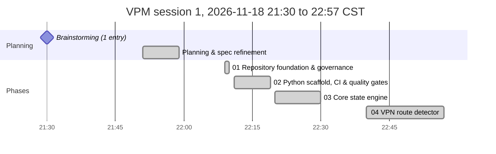
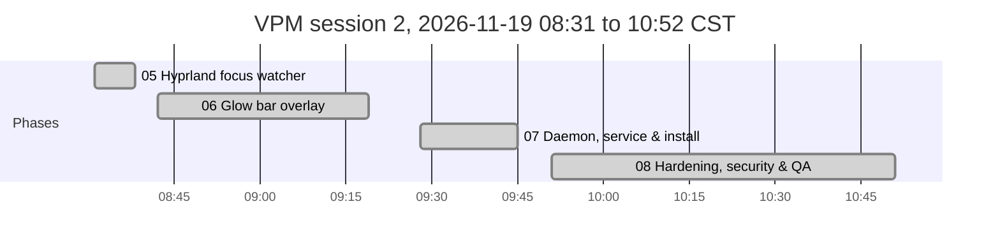
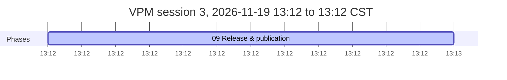

# VPM: VPN Monitor Implementation Plan

**Spec:** [`docs/VPM_SPECIFICATION.md`](docs/VPM_SPECIFICATION.md). **Decisions:** [`docs/VPM_DECISIONS.md`](docs/VPM_DECISIONS.md). **Agent rules:** [`CLAUDE.md`](CLAUDE.md). **Shared phase instructions:** [`prompts/VPM_shared-instructions.md`](prompts/VPM_shared-instructions.md)
**Last updated:** 2026-11-19 10:51 CST (Phase 08, hardening, security & QA)
**Brainstorm:** VPM_Brainstorming.md
The brainstorm is traced in the spec's Amendments ("Brainstorm trace") and drawn in the timeline's Planning lane.

> ⚠️ **Mandatory:** every agent that works on this project keeps this file accurate. **Before doing any other work, set your phase to `🔄 In progress` and commit that change to `main`** (claim protocol: `prompts/VPM_shared-instructions.md` §1a). Other agents read this table from `main`. At the end, set it to `✅ Complete` or `⛔ Blocked` and add a Phase Log entry. See `CLAUDE.md`.

## How to run a phase
Open Claude Code in `/home/nick/Work/VPNMonitor` and type one of:
- `/phase`: run the next eligible phase. It checks dependencies, tells you if you're on the wrong model, resumes an `In progress` phase, and asks about any open questions it needs.
- `/phase NN`: run a specific phase.
- `/phase status`: show progress and what's next, without doing any work.
- `/phase-add [after NN] <request or file>`: plan a new lettered phase (`07a`) from a change request. No product work, no claim.

**Optional hands-off runs (PhaseHypervisor):** `phx preflight /home/nick/Work/VPNMonitor` asks the foreseeable questions once, then `phx run /home/nick/Work/VPNMonitor` runs the remaining phases unattended through `/phase NN --auto`, honouring the Gate column. Manual `/phase` stays the standard way; you can switch between the two at any phase boundary, and `/phase` stops if a `phx` supervisor is running this plan.

The agent merges a completed phase into `main` and pushes it without asking (Nick's standing git authority); review its close-out summary.

Each phase is claimed by a `chore(plan): start phase NN` commit on `main` and runs in its own worktree, `../VPNMonitor-phase-NN`, so parallel sessions never share a checkout. `/phase status` flags any branch or worktree whose row is not `🔄 In progress`.

**Parallelism:** after Phase 03, Phases **04, 05 and 06** are independent (each builds against the Phase 02 interfaces and fakes) and can run in parallel sessions. Everything else is sequential. Phases 04 and 07 need Nick at the keyboard briefly (he toggles the VPN himself); Phase 06 needs his approval of the screenshots.

**Gate column** (read only by PhaseHypervisor; manual `/phase` ignores it): `auto` = may run unattended; `review` = pause for Nick after it; `owner` = Nick starts it. Empty means `auto`.

**Status values:** ⬜ Not started · 🔄 In progress · ⛔ Blocked · ✅ Complete. Always write the icon **and** the word.

## Phases

| Phase | Phase Name | Phase Purpose | AI Model to Use | Depends on | Status | Prompt to Initiate This Phase | Gate |
|---|---|---|---|---|---|---|---|
| 00 | Planning & spec refinement | Review source docs, resolve decisions, write the spec, plan and prompts | Claude Opus 5.5 | none | ✅ Complete | n/a (planning session) | owner |
| 01 | Repository foundation & governance | Governance files, docs skeleton, gitleaks, private GitHub repo | Claude Sonnet 5.5 (`/model sonnet`) | 00 | ✅ Complete | [`prompts/VPM_phase-01-repo-foundation.md`](prompts/VPM_phase-01-repo-foundation.md) | auto |
| 02 | Python scaffold, CI & quality gates | Package, shared types, Protocols, fakes, CLI stub, CI, architecture doc | Claude Sonnet 5.5 (`/model sonnet`) | 01 | ✅ Complete | [`prompts/VPM_phase-02-python-scaffold-ci.md`](prompts/VPM_phase-02-python-scaffold-ci.md) | auto |
| 03 | Core state engine | Pure decision engine (no false blue), browser matcher, config, event log | Claude Opus 5.5 (`/model opus`) | 02 | ✅ Complete | [`prompts/VPM_phase-03-core-state-engine.md`](prompts/VPM_phase-03-core-state-engine.md) | auto |
| 04 | VPN route detector | Route probes per family, interface classifier, leak/fail-safe rules, change watcher | Claude Opus 5.5 (`/model opus`) | 03 | ✅ Complete | [`prompts/VPM_phase-04-vpn-detector.md`](prompts/VPM_phase-04-vpn-detector.md) | auto |
| 05 | Hyprland focus watcher | socket2 events → FocusEvent (no titles), initial state, reconnect, real classes | Claude Sonnet 5.5 (`/model sonnet`) | 03 | ✅ Complete | [`prompts/VPM_phase-05-hyprland-focus-watcher.md`](prompts/VPM_phase-05-hyprland-focus-watcher.md) | auto |
| 06 | Glow bar overlay | Click-through layer-shell red/blue glow bar, fades, multi-monitor, screenshots approved by Nick | Claude Opus 5.5 (`/model opus`) | 03 | ✅ Complete | [`prompts/VPM_phase-06-glow-bar-overlay.md`](prompts/VPM_phase-06-glow-bar-overlay.md) | review |
| 07 | Daemon, service & install | Wiring, control socket, CLI, systemd user unit, pause keybinding, install/uninstall, OSMods | Claude Sonnet 5.5 (`/model sonnet`) | 04, 05, 06 | ✅ Complete | [`prompts/VPM_phase-07-daemon-service-install.md`](prompts/VPM_phase-07-daemon-service-install.md) | review |
| 08 | Hardening, security & QA | Threat model, fault injection, scanners, measured performance, log hygiene, follow-ups | Claude Opus 5.5 (`/model opus`) | 07 | ✅ Complete | [`prompts/VPM_phase-08-hardening-security-qa.md`](prompts/VPM_phase-08-hardening-security-qa.md) | auto |
| 09 | Release & publication | v1.0.0 tag, final report with timeline, publish only on Nick's yes | Claude Sonnet 5.5 (`/model sonnet`) | 08 | 🔄 In progress | [`prompts/VPM_phase-09-release-publication.md`](prompts/VPM_phase-09-release-publication.md) | review |

## Timeline
Generated by `scripts/phase_timeline.py` from the Phase Log and git; refreshed on `main` at every close-out, block, resume and `/phase-add`. Do not edit between the markers.

<!-- phase-timeline:start (generated by scripts/phase_timeline.py; do not edit) -->


*Generated from the Phase Log Timeline bullets and git, as of 2026-11-19 13:12 CST. ≈ marks a time inferred from git or a heading. Idle gaps over 60 min start a new chart below and are collapsed in the image. Regenerate with `python3 scripts/phase_timeline.py --write`; do not edit by hand.*







| Phase | Name | Started | Finished | Merged | Active | Blocked | Claim |
|---|---|---|---|---|---:|---:|---|
| brainstorm | Brainstorming (1 entry) | 2026-11-18 21:30 CST |  |  |  |  | n/a |
| 00 | Planning & spec refinement | 2026-11-18 21:51 CST | 21:59 |  | 8 m |  | n/a |
| 01 | Repository foundation & governance | 2026-11-18 22:09 CST | 22:10 | 22:10 | 1 m |  | `d547144` |
| 02 | Python scaffold, CI & quality gates | 2026-11-18 22:11 CST | 22:19 | 22:19 | 8 m |  | `fb6aca4` |
| 03 | Core state engine | 2026-11-18 22:20 CST | 22:30 | 22:30 | 10 m |  | `38929c7` |
| 04 | VPN route detector | 2026-11-18 22:40 CST | 22:57 | 22:57 | 17 m |  | `ac402ee` |
| 05 | Hyprland focus watcher | 2026-11-19 08:31 CST | 08:38 | 08:38 | 7 m |  | `0f2c09f` |
| 06 | Glow bar overlay | 2026-11-19 08:42 CST | 09:19 | 09:19 | 37 m |  | `80167dc` |
| 07 | Daemon, service & install | 2026-11-19 09:28 CST | 09:45 | 09:46 | 17 m |  | `d0c9e5b` |
| 08 | Hardening, security & QA | 2026-11-19 09:51 CST | 10:51 | 10:52 | 1 h |  | `e6af273` |
| 09 | Release & publication | 2026-11-19 13:12 CST | (in progress) |  | < 1 m so far |  | `ca4a0a9` |

**Totals:** elapsed 15 h 42 m (first recorded start to 2026-11-19 13:12 CST) · active phase time 2 h 37 m (sum over phases) · blocked or paused 0 m · idle 11 h 54 m in 2 gap(s) over 60 min.
<!-- phase-timeline:end -->

### Model rationale
- **Opus 5.5** where a subtle mistake would make the indicator lie or the desktop misbehave: **03** (the decision engine and its "never a false blue" invariant), **04** (route/policy-routing parsing and leak classification, security-critical), **06** (GTK4 layer-shell drawing, scaling, animation without idle redraws, click-through; complex interactive UI), **08** (security review and fault injection).
- **Sonnet 5.5** for well-specified work: **01** (governance files), **02** (scaffolding and CI), **05** (Hyprland's line protocol is simple and documented; the risky part, title stripping, is spelled out and tested), **07** (wiring against finished components, systemd unit, install scripts), **09** (release paperwork).
- Fable 5.2 is not needed for any phase: no phase needs deeper reasoning than Opus gives, and it costs more.

### Dependency graph
```
00 ─► 01 ─► 02 ─► 03 ─┬─► 04 (VPN detector) ──────┐
                      ├─► 05 (focus watcher) ─────┼─► 07 (daemon + install) ─► 08 (hardening) ─► 09 (release)
                      └─► 06 (overlay, review) ───┘
```
Parallel: 04 ∥ 05 ∥ 06.

### Definition of done (checked in the final phase)
- [ ] With a browser or Omarchy web app focused, the bottom edge of its monitor glows **blue** when internet routes leave via a VPN and **red** otherwise; no bar when a non-browser is focused.
- [ ] A VPN drop shows red within 2 s; a focus change updates the bar within 150 ms (measured).
- [ ] No false blue in any tested fault (unknown, stale, split-tunnel leak, watcher crash, suspend).
- [ ] Window titles never appear in logs or state; no external network calls (tests + log audit).
- [ ] Idle cost ~0 % CPU with no browser focused (measured).
- [ ] Runs at login as a systemd user service; pause/resume keybinding and CLI work; install/uninstall are clean and documented in OSMods.
- [ ] Nick approved the look (Phase 06 screenshots).
- [ ] All governance files present; CI green; tag `v1.0.0`; final report with generated timeline.
- [ ] Every brainstorm trace row is fulfilled or has a recorded disposition.
- [ ] Repo visibility and release state match Nick's recorded answer.

## Owner questions
| # | Question | Status / proposed default | Needed by |
|---|---|---|---|
| 1 | Pause/resume keybinding (SUPER+ALT+V is taken by Prometheus) | Answered (2026-11-19 09:45 CST, Phase 07, ADR-0009): SUPER+ALT+SHIFT+V, checked free; Nick pressed it live | Phase 07 |
| 2 | Exact look: thickness, glow, red and blue shades | Answered (2026-11-19 09:19 CST, Phase 06, ADR-0017): Nick asked for "a little more subtle" and chose variant B: 2 px core + 10 px glow, `#FF3B30CC` / `#0A84FFCC` (80 % opacity), 150 ms fades | Phase 06 |
| 3 | Show the bar over a fullscreen browser (videos)? | Answered (2026-11-19 09:19 CST, Phase 06): yes (`indicator.show_on_fullscreen = true`) | Phase 06 |
| 4 | How long does a pause last? | Answered (2026-11-19 09:45 CST, Phase 07, ADR-0018): until resumed or next login (not persisted); `pause.auto_resume_minutes` is optional | Phase 07 |
| 5 | Add DNS-leak detection? | Deferred (2026-11-18 21:58 CST): out of this plan; add later with `/phase-add` if wanted | none |
| 6 | Make the GitHub repo public and/or publish a release? | Open (asked 2026-11-18 21:58 CST, Phase 00). Proposed default: stays private, no release | Phase 09 |
| 7 | GitHub Actions refuses to start CI jobs (account billing: "recent account payments have failed or your spending limit needs to be increased"); fix billing so CI can show green before the release? | Open (asked 2026-11-19 10:05 CST, Phase 08). Nick: "I'll fix billing later". Proposed default: re-run CI on `main` once fixed; local runs of the CI recipe stand in until then | Phase 09 |

## Phase Log
Newest entries at the bottom. Format: `### YYYY-MM-DD HH:MM TZ: Phase NN: <title> (<status>)` (timestamp from `date '+%Y-%m-%d %H:%M %Z'`, never a bare date). **The first bullet is always the Timeline:** `- **Timeline:** started <TS> (claim commit <hash>) · finished <TS> · merged <TS | not merged yet>` (add ` · blocked <TS> to <TS>` per `⛔` interval; *started* is the claim commit's time). Then bullets: built, deviations, follow-ups, tests.

### 2026-11-18 21:59 CST: Phase 00: Planning & spec refinement (✅ Complete)
- **Timeline:** started 2026-11-18 21:51 CST · finished 2026-11-18 21:59 CST
- **Brainstorm:** `VPM_Brainstorming.md`, 1 entry from 2026-11-18 21:30 CST to 2026-11-18 21:30 CST; 6 adopted, 0 deferred, 0 dropped (spec Amendments, "Brainstorm trace"); covered through 2026-11-18 21:30 CST.
- Read the brainstorm in full and inspected the machine (Hyprland 0.56.2 Lua config, ProtonVPN WireGuard `proton0` with policy routing and IPv6 leak guard, Tailscale, Brave/Chromium, gtk4-layer-shell, Python 3.14.8, existing keybindings). Feasibility confirmed: yes (spec R1).
- Owner decisions (one round): red/blue steady glow while a browser is focused; VPN = traffic actually routed via a VPN; browsers include Omarchy web apps; always-on user service with a pause key. Prefix `VPM` taken from the brainstorm file name.
- Refinements: pure engine with fail-safe red (R2, R4), per-family route probes with leak detection (R3), event-driven detection with re-check only while a browser is focused (R5), privacy baseline (no titles, no network calls), performance budget (R13).
- Found: SUPER+ALT+V is already bound (Prometheus), so the pause key default is SUPER+ALT+SHIFT+V (owner question 1).
- Wrote: spec with Amendments and brainstorm trace, ADR-0001…0010, this plan with 9 phases, shared instructions, phase prompts, `CLAUDE.md`, `/phase` and `/phase-add`, change-request template, vault note `02 Projects/VPM Implementation Plan.md`, timeline generator.
- Timeline tooling workarounds (skill bugs, reported to Nick, not fixed in PhaseHypervisor): the plan template's `**Brainstorm:**` line had trailing text that `phase_timeline.py` read as part of the file name, so the description moved to its own line; the brainstorm stamp had no zone and was read as UTC, so ` CST` was added to its single header line in `VPM_Brainstorming.md`.
- Tests: none (planning only).

### 2026-11-18 22:10 CST: Phase 01: Repository foundation & governance (✅ Complete)
- **Timeline:** started 2026-11-18 22:09 CST (claim commit d547144) · finished 2026-11-18 22:10 CST · merged 2026-11-18 22:10 CST
- **Model:** ran as Claude Sonnet 5.5 (plan lists Sonnet 5.5)
- **Built:** `LICENSE` (MIT), `NOTICE`, `README.md`, `SECURITY.md`, `CONTRIBUTING.md`, `CODE_OF_CONDUCT.md` (Contributor Covenant 2.1), `CHANGELOG.md`, `THIRD_PARTY_NOTICES.md` (licences read from `pacman -Qi`: gtk4 LGPL-2.1-or-later, gtk4-layer-shell MIT, python-gobject LGPL-2.1-or-later), `.gitignore` (extended the existing file), `.dockerignore`, `.editorconfig`, `.github/` (bug and feature templates, PR template, Dependabot for github-actions), `docs/README.md`, `docs/screenshots/.gitkeep`, `.pre-commit-config.yaml` (gitleaks v8.30.1, pre-commit-hooks v6.0.0, both verified as latest releases).
- **Deviations:** the Phase 01 prompt named the copyright holder "Nick Antoncic"; the git identity and GitHub account say "Nick Antonizick", so the licence and notice use that spelling (treated as a typo in the prompt). The `end-of-file-fixer` hook excludes `VPM_Brainstorming.md` (owner's source file, left byte-for-byte unchanged); it added a final newline to `prompts/VPM_shared-instructions.md`.
- **Follow-ups:** Phase 02 adds the pip/uv Dependabot entry, CI, and dev-tool licences in THIRD_PARTY_NOTICES; CONTRIBUTING setup commands are placeholders until then.
- **Tests:** `pre-commit run --all-files` passes (gitleaks finds nothing); no `{{` template markers in governance files. No code, so no pytest.

### 2026-11-18 22:19 CST: Phase 02: Python scaffold, CI & quality gates (✅ Complete)
- **Timeline:** started 2026-11-18 22:11 CST (claim commit fb6aca4) · finished 2026-11-18 22:19 CST · merged 2026-11-18 22:19 CST
- **Model:** ran as Claude Sonnet 5.5 (plan lists Sonnet 5.5)
- **Built:** `pyproject.toml` (hatchling, no runtime deps, dev group pytest/pytest-cov/ruff/mypy locked in `uv.lock`, ruff + `mypy --strict` on `src/`, `gi`/`wayland` markers); `src/vpn_monitor/` with `model.py` (frozen types, no title field anywhere, `FocusSource`/`VpnSource`/`IndicatorSink` Protocols), stubs for engine (shaped as the Phase 03 `Engine` class), browsers, config, eventlog, vpn, focus, overlay, control, daemon, `fakes.py`, `cli.py` (spec R10 subcommands, stubs exit 2) and `__main__.py`; tests (20 pass: model immutability and no-title, CLI, fakes, Protocol conformance) with a `conftest.py` that skips `gi`/`wayland` tests; `.github/workflows/ci.yml` (Python 3.12 + 3.14, actions pinned by SHA) and a Dependabot `uv` entry; `docs/VPM_ARCHITECTURE.md`; CONTRIBUTING setup, README, CHANGELOG, THIRD_PARTY_NOTICES (dev licences), CLAUDE.md test line confirmed.
- **ADRs:** ADR-0006 verified and Accepted (`gi` + `Gtk4LayerShell` import without `LD_PRELOAD`; library `/usr/lib/libgtk4-layer-shell.so`); new ADR-0011 (callback-style Protocols) and ADR-0012 (single GLib main loop).
- **Findings:** `uv` picks a uv-managed Python 3.13 that cannot import the system `gi`, so `[tool.uv] python-preference = "only-system"` is set; CI overrides it with `UV_PYTHON_PREFERENCE=managed`. `ruff format` would rewrite `scripts/phase_timeline.py` (copied from the skill), so it is excluded from ruff. `pre-commit` is not run in CI (documented in CONTRIBUTING).
- **Deviations:** acceptance item "CI run green on GitHub" is **not met**: GitHub Actions refuses to start jobs ("recent account payments have failed or your spending limit needs to be increased", run https://github.com/antonizick/VPNMonitor/actions/runs/44457085826). Nick chose to close the phase with CI deferred. The CI recipe was verified locally instead: `uv sync --frozen --python 3.12` on a managed interpreter, then mypy and pytest pass (3.12.15 and system 3.14.8). The workflow also triggers on `phase-*` branches.
- **Follow-ups:** fix GitHub billing, then re-run the CI workflow on `main` and record the result; adding a Phase 08 check that CI is green before release.
- **Tests:** `uv run ruff check . && uv run ruff format --check . && uv run mypy src && uv run pytest` all pass locally (20 passed); `pre-commit run --all-files` passes.

### 2026-11-18 22:30 CST: Phase 03: Core state engine (✅ Complete)
- **Timeline:** started 2026-11-18 22:20 CST (claim commit 38929c7) · finished 2026-11-18 22:30 CST · merged 2026-11-18 22:30 CST
- **Model:** ran as Claude Opus 5.5 (plan lists Opus 5.5)
- **Built:** `engine.py` (`Engine` with `on_focus/on_vpn/on_pause/on_monitors/tick`, returns a Decision only when indicator, monitor or reason changes; `reading_problem()` as the single gate for blue; `next_deadline()` and `active` for the daemon; `from_config`), `browsers.py` (`BrowserMatcher`, exact classes + `re.fullmatch` regexes, reports the matching rule), `config.py` (frozen `Config` with sections browsers/probes/vpn/indicator/appearance/pause/log, defaults in code, strict validation naming the key, unknown keys as warnings, cross-field timing rules), `eventlog.py` (`EventLog`: human log + JSONL in `$XDG_STATE_HOME/vpn-monitor/`, 0700, size rotation, fixed schema; `TitleGuard`), `config/config.example.toml` (every key, equal to the defaults). Docs: architecture (engine rules table, matcher, config, event schema), README configuration section, SECURITY S1 note, CHANGELOG, ADR-0013 (engine rules and hysteresis), ADR-0014 (event-log format), brainstorm trace B2, notes for the Phase 04–07 prompts.
- **Deviations:** `red_confirm_ms` exists but must be 0 (anything else is a `ConfigError`): a red delay would keep a false blue on screen, which S6 forbids (ADR-0013). Beyond the prompt, the engine cross-checks a `VPN` reading against its routes (defence in depth; also makes "everything blocked, no tunnel" red as R4 requires) and rejects NaN or future-dated readings. The clock is injected in the constructor (`clock()`), and `tick(now)` also accepts an explicit time. With no resolvable monitor the decision is HIDDEN. New config keys not named in the prompt: `appearance.fade_ms`, `pause.auto_resume_minutes` (owner question 4; 0 = until resume or next login), `vpn.probe_timeout_s`, `[log]` rotation. `browsers.is_browser()` stub removed (unused). No `hypothesis` dependency: the S6 property tests are an exhaustive `itertools.product` table plus 200 seeded random event sequences.
- **Owner questions:** none needed. Q3 (fullscreen) is a config key defaulting to `true` as proposed and stays open for the Phase 06 review; Q4 is the `pause.auto_resume_minutes` key (default 0) for Phase 07.
- **Follow-ups:** Phase 07 must schedule a timer at `engine.next_deadline()` after each input (recorded in its prompt). GitHub CI is still blocked by account billing (Phase 02 follow-up).
- **Tests:** 510 passed (490 new); coverage 100 % for `engine.py`, `browsers.py`, `config.py` and `eventlog.py`. Mutation checks: removing the staleness check, the leak check or the pause rule each fails the suite. `uv run ruff check . && uv run ruff format --check . && uv run mypy src && uv run pytest` pass; `pre-commit run --all-files` passes. `load_config(config/config.example.toml) == Config()` is True.

### 2026-11-18 22:57 CST: Phase 04: VPN route detector (✅ Complete)
- **Timeline:** started 2026-11-18 22:40 CST (claim commit ac402ee) · finished 2026-11-18 22:57 CST · merged 2026-11-18 22:57 CST
- **Model:** ran as Claude Opus 5.5 (plan lists Opus 5.5)
- **Built:** `vpn.py`: `RouteProbe` (`ip -4|-6 -j route get`, fixed argv, `LC_ALL=C`, 1 s timeout; timestamp taken before probing), `LinkClassifier` (kernel link kind from `ip -d -j link show`: `wireguard`/`tun` = VPN, `dummy` = blocked; plus `vpn.interface_patterns` / `vpn.leak_guard_interfaces` globs; cached, reloaded per change burst), `combine()` (spec R3: leak → NO_VPN, error → UNKNOWN, nothing via VPN → NO_VPN, else VPN; a crash → UNKNOWN), `RouteWatcher` (the `VpnSource`: `ip monitor route rule link` through fd watches, 200 ms leading-window debounce, re-check every 5 s only while active, restart with back-off 0.5→30 s, `VPN` downgraded to `UNKNOWN` while the monitor is down > `max_reading_age_s`, `reading`/`vpn_watcher` log events with trigger and latency). `mainloop.py` (`Scheduler` Protocol, `GLibScheduler` using `GLibUnix.fd_add_full`), `fakes.FakeScheduler`, `vpn-monitor probe [--json] [--watch [--log]] [--config]` (exit 0 VPN / 1 NO_VPN / 3 UNKNOWN / 2 config error). Fixtures in `tests/fixtures/routes/` (4 recorded, 6 synthesised, sanitised).
- **Live verification (Nick toggled ProtonVPN, 22:53–22:54 CST):** VPN up: both families via `proton0` (wireguard, table 245447468); Proton now gives IPv6, so `ipv6leakintrf0` is only used during teardown. Disconnected: IPv4 via `wlo1` (leak) and IPv6 unreachable → NO_VPN **228 ms** after the first route event. Reconnecting: both families into the kill-switch dummy `pvpnksintrf0` → NO_VPN (red), then VPN 222 ms after the route event. Probe cost ≈ 12 ms. `vpn-monitor probe` with Proton up reports VPN with both families explained. All three acceptance criteria met.
- **Deviations:** (1) Classification uses the kernel link kind instead of `nmcli` (ADR-0015, spec AM-1), so it is generic, as Nick asked mid-phase ("I'm hoping this tool is a generic VPN detector"); any `dummy` device counts as blocked. (2) The monitor also watches `rule` (Proton switches policy rules). (3) `vpn.leak_guard_interfaces` defaults changed to `ipv6leakintrf*`, `pvpnksintrf*`, `pvpnrouteintrf*` (names read from the installed Proton client; config example and README updated). (4) Fixture destinations are documentation addresses (`192.0.2.1`, `2001:db8::1111`) so no fixture holds a public IP. (5) The kernel error "Invalid argument" (possibly an IPv4 blackhole) stays `ERROR` (red) rather than guessing `BLOCKED`. ADR-0007 Accepted with the event-source choice and measurements.
- **Findings:** the phase worktree's venv must be made with `uv venv --system-site-packages` (as CONTRIBUTING says); a plain `uv sync` venv silently skips the `gi` tests. Noted in the Phase 05 prompt.
- **Follow-ups:** Phase 07 wires `RouteWatcher` (notes added to its prompt); Phase 08 measures end-to-end drop → red through the daemon (note added). Policy-based IPsec without an interface shows red (README limits). GitHub CI still blocked by account billing (Phase 02 follow-up).
- **Tests:** 634 passed (124 new: fixture scenarios, every kernel answer and failure, classifier fallbacks and caching, all 25 per-family combinations cross-checked against `engine.reading_problem`, watcher debounce/re-check/back-off/restart/blind downgrade/logging/stop, real subprocess stream, GLib scheduler, CLI `probe`, fixture privacy scan, no network imports). Coverage: `vpn.py` 99 %, `mainloop.py` 100 %. `uv run ruff check . && uv run ruff format --check . && uv run mypy src && uv run pytest` pass; `pre-commit run --all-files` passes.

### 2026-11-19 08:38 CST: Phase 05: Hyprland focus watcher (✅ Complete)
- **Timeline:** started 2026-11-19 08:31 CST (claim commit 0f2c09f) · finished 2026-11-19 08:38 CST · merged 2026-11-19 08:38 CST
- **Model:** ran as Claude Sonnet 5.5 (plan lists Sonnet 5.5)
- **Built:** `focus.py`: pure parser (`parse_event_line`, `parse_active_window`, `parse_monitors`, `parse_clients`; titles dropped there: `activewindow>>class,title` keeps only the class, title-bearing events are reduced to their name, JSON replies are read field by field, parse errors never quote the reply), `locate_sockets` (signature, else newest live instance; `HyprlandNotRunning`), `SocketEventStream`, `HyprlandClient` (`j/activewindow`, `j/monitors` id → name table, `j/clients` for diagnostics), `FocusWatcher` (the `FocusSource`: "no focus" first, initial state, one request per event batch, deliver only changes, "no focus" while disconnected or when a request fails, reconnect 0.1 s doubling to 5 s reset after 10 s, one log line per distinct error, `focus` events logged with class/monitor/fullscreen/trigger, `last_latency_s`). `vpn-monitor focus [--watch] [--json] [--log] [--config]` (exit 0 browser / 1 other / 2 no Hyprland or bad config). Fixtures `tests/fixtures/focus/` (`classes.json`, `socket2.txt` with hostile titles).
- **Live verification (reference machine, 2026-11-19 08:35 CST):** `vpn-monitor focus --watch` while focus was switched between foot and Brave (via `hl.dsp.focus`): each change printed with 5 to 6 ms from receipt to delivery (earlier run 2 to 7 ms), correct class, rule and monitor (`HDMI-A-1`); acceptance limit is 150 ms. Observed classes: `brave-browser`, `brave-maps.google.com__-Default` (an Omarchy web app launched with `omarchy-launch-webapp`; matches the default regex), `foot`, `md.obsidian.Obsidian`, `proton.vpn.app.gtk`, `Lucent-desktop`. Chromium and KeePassXC were not running; their classes follow Chromium's documented naming and are marked "expected" in the fixture. The default matcher needed no change.
- **Deviations:** (1) Focus is resolved by `j/activewindow` per event batch instead of an address → class cache (ADR-0016), because monitor and fullscreen are not in the events. (2) Reconnect after a Hyprland restart also works when `$HYPRLAND_INSTANCE_SIGNATURE` is stale (falls back to the newest live instance). (3) `focusedmon`, `fullscreen`, `movewindow*` also trigger a refresh. (4) I launched one Omarchy web app (Google Maps) on Nick's desktop to observe its class; my first attempt to close it used the old `hyprctl dispatch` syntax and was rejected, and the window was gone by my next check (I do not know whether Nick closed it). During the live test I also moved focus between Nick's existing foot and Brave windows with `hl.dsp.focus`; nothing was closed, moved or typed into. (5) Hyprland's request socket was not restarted, as required; the reconnect is tested with a real Unix socket server and a socketpair double.
- **Follow-ups:** Phase 07 wires `FocusWatcher` (notes added to its prompt). Phase 06 does not depend on this. `hyprctl dispatch` uses Lua syntax on this machine (`hl.dsp.focus({ window = "address:0x…" })`), noted for scripted tests in Phase 08.
- **Tests:** 692 passed (58 new: parser incl. commas and `>>` in titles, fixture stream, fullscreen modes, socket location and fallback, real-socket request, watcher coalescing, partial and oversized lines, hang-up and read-error reconnect, back-off 0.1 → 5 s and reset, not-running at start, request failure, stop, real Unix-socket reconnect, S1 `TitleGuard` over events and logs, error de-duplication, CLI `focus`). `focus.py` coverage 97 %. `uv run ruff check . && uv run ruff format --check . && uv run mypy src && uv run pytest` pass.

### 2026-11-19 09:19 CST: Phase 06: Glow bar overlay (✅ Complete)
- **Timeline:** started 2026-11-19 08:42 CST (claim commit 80167dc) · finished 2026-11-19 09:19 CST · merged 2026-11-19 09:19 CST
- **Model:** ran as Claude Opus 5.5 (plan lists Opus 5.5)
- **Built:** `overlay.py`: pure helpers (`parse_colour`, `snap_to_device`, `glow_stops`, `ease`, `Look`, `Fade` animator with injected time), `paint()` (device-pixel-snapped core + 10-stop gradient glow), `Bar` (per-monitor state machine over a `BarSurface`, draw and idle-draw counters), `GlowOverlay` (the `IndicatorSink`: bar only on the Decision's monitor, idempotent, monitor unplug/replug, toolkit faults logged as `overlay_error`, `overlay`/`overlay_settled`/`overlay_monitor*` events), `GtkBackend`/`GtkSurface` (layer OVERLAY, anchors bottom/left/right, exclusive zone 0, keyboard NONE, namespace `vpn-monitor`, empty input region on every map), `ensure_layer_shell()` (one `LD_PRELOAD` re-exec, guarded), cairo renderer by default. `vpn-monitor preview red|blue|cycle [--seconds] [--monitor] [--backdrop] [--log] [--config]`, `scripts/preview.sh`, screenshots `docs/screenshots/vpm-bar-red.png` / `vpm-bar-blue.png` (over a plain fullscreen backdrop, nothing personal).
- **Visual review (owner questions 2 and 3):** Nick saw the first version (3 px + 12 px) live and in screenshots and answered: "Can you make it a little more subtle and show me a more subtle implementation?" Two variants ran live (A: 2 px + 8 px; B: 2 px + 10 px at 80 % opacity); he chose **"B: 2 px + 10 px, 80 %"**, now the defaults in `config.py` and `config/config.example.toml`, screenshots regenerated. Fullscreen: "Yes, show it (Recommended)". Click-through: "Yes, clicks pass through" (Nick clicked through the live bar).
- **Acceptance:** screenshots committed and approved (above). Clicks reach the window underneath (Nick, live; plus the wayland test asserts an empty input region). No redraws after a fade: `preview` draw counter shows 0 idle redraws in every run (e.g. blue: 9 draws in the 150 ms fade, then 1 final frame, then nothing for 25 s); `overlay_settled` debug events carry the count.
- **Measured (reference machine, HDMI-A-1 3840×2160 @ 1.6, bar shown and settled):** default GPU renderer RSS 154 MB, 11 threads, ~0.35 % CPU; with `GSK_RENDERER=cairo` RSS 105 MB, PSS 58 MB, 6 threads, **0 CPU ticks over 20 s**, 0 idle redraws. A bare GTK layer window without our code has the same wake-up profile. Core line renders as exactly 5 device rows of the configured colour at scale 1.6 (pixel check of the screenshot).
- **Deviations:** (1) `LD_PRELOAD` *is* needed for a real window (ADR-0006's Phase 02 note checked only the import): without it `is_supported()` is False; `GtkBackend` refuses to run rather than open a normal window. (2) `GSK_RENDERER=cairo` default (ADR-0017, spec AM-2), not in the prompt. (3) The fade starts at the first frame after mapping, because the first map takes ~150 to 200 ms and would otherwise swallow the fade-in. (4) No cross-fade screenshot: `grim` takes longer to start than the 150 ms fade. (5) Fullscreen verified over the preview's own fullscreen backdrop window, not a Brave video; Nick approved showing it over fullscreen. (6) `--backdrop` takes keyboard focus while open (documented); used only for the screenshot runs. (7) Added runtime system dependency `python-cairo` to README, CONTRIBUTING and THIRD_PARTY_NOTICES (LGPL-2.1 OR MPL-1.1).
- **Follow-ups:** Phase 07 calls `ensure_layer_shell(argv)` before Gtk and builds `GlowOverlay(config.appearance, log=log)` (notes added to its prompt). Phase 08 reports PSS next to RSS against R13's 80 MB (RSS 105 MB includes shared GTK libraries) and runs a 10-minute idle-redraw check (notes added). GitHub CI still blocked by account billing (Phase 02 follow-up). No host changes in this phase (nothing installed; previews ran in the foreground).
- **Tests:** 755 passed (63 new: colour parsing, snapping, gradient stops, easing, `Fade` incl. interrupt and zero duration, `Bar` state machine with a fake frame clock (no redraws after a fade, slow first map, hide unmaps, cross-fade without remap, idempotent), `paint` against a real cairo image, `GlowOverlay` over a fake backend (one monitor only, idempotent, unknown monitor, unplug/replug, toolkit fault, logging, close), `LD_PRELOAD` re-exec command, CLI preview helpers, no network/title access; one `wayland` test runs the real GTK backend in a subprocess and checks layer, anchors, exclusive zone, keyboard mode, namespace, monitor, empty input region, height, unmap after hide and no idle draws). `overlay.py` coverage 99 %. `uv run ruff check . && uv run ruff format --check . && uv run mypy src && uv run pytest` pass; `pre-commit run --all-files` passes.

### 2026-11-19 09:45 CST: Phase 07: Daemon, service & install (✅ Complete)
- **Timeline:** started 2026-11-19 09:28 CST (claim commit d0c9e5b) · finished 2026-11-19 09:45 CST · merged 2026-11-19 09:46 CST
- **Model:** ran as Claude Sonnet 5.5 (plan lists Sonnet 5.5)
- **Owner questions:** #1 answered: SUPER+ALT+SHIFT+V. #4 answered: pause lasts until resumed or next login. Both asked at the start of the session (interactive).
- **Built:** `daemon.py` (`Daemon` with injected parts; one deadline timer; fail-safe to red on any callback or engine error; SIGTERM/SIGINT clean stop; SIGHUP reload with replay), `control.py` (0700/0600 socket, `SO_PEERCRED`, one JSON line, fixed commands, `flock` single instance, client), CLI `run`, `pause`, `resume`, `toggle`, `status [--json]`, `log [-f] [--events]` with `notify-send`, `sound.py` (soft falling/rising cue on pause/resume, added at Nick's request mid-phase; `pause.sound`, `pause.sound_volume`), `packaging/systemd/vpn-monitor.service`, `scripts/install.sh`, `uninstall.sh`, `vpn-monitor` wrapper; ADR-0018, ADR-0009 accepted, spec AM-3, B1 trace updated, README/SECURITY/ARCHITECTURE/CHANGELOG, Phase 08 notes, OSMods `VPN Monitor.md` + README.
- **Live check (Nick, 2026-11-19):** blue on Brave, blue on a web app, none on foot. ProtonVPN disconnected and reconnected by Nick with the Proton app focused: `ip monitor` event to reading 229 ms (disconnect) and 222 ms (reconnect); red then blue on the next browser focus. Pause key logged `pause` 09:42:05 then `resume` 09:42:18; the audio cue was audible at the right level (Nick). Service: 0 restarts; `systemd-analyze --user security`: **1.6 OK** (no IP sockets possible).
- **Deviations:** (1) Fixed a Phase 04 performance bug found live: child `ip` processes inherited the daemon's `LD_PRELOAD=libgtk4-layer-shell.so`, making probes 300 to 400 ms (a ~0.3 s red flash whenever a browser gained focus); `vpn._c_env` drops it (20 ms; reading age at start 6 ms). (2) Unit uses `StateDirectory`/`RuntimeDirectory` instead of `ReadWritePaths`, and adds `SystemCallFilter`, `RestrictNamespaces`, `ProtectProc`; no `LD_PRELOAD` in the unit (the daemon re-execs itself). (3) The first live key press was not logged; Nick pressed again and it was verified from the log. (4) `run --foreground` only adds a start-up line; the daemon never forks. (5) The end-to-end drop-to-red-on-screen time with a browser focused was not measured separately (Phase 08).
- **Follow-ups:** after merge the installed symlink must point at the main checkout (re-run `scripts/install.sh` there); Phase 08 measures drop to red on screen, the 150 to 200 ms first-map delay and PSS (notes added to its prompt); a slow same-uid control client can block the loop for up to 0.5 s (documented). GitHub CI still blocked by billing (Phase 02 follow-up).
- **Tests:** 857 passed (102 new: daemon pipeline, control socket, CLI, sound, install/uninstall against a temp HOME). Coverage: `daemon.py` 99 %, `control.py` 97 %, `sound.py` 100 %, `cli.py` 99 %. `uv run ruff check . && uv run ruff format --check . && uv run mypy src && uv run pytest` and `pre-commit run --all-files` pass.

### 2026-11-19 10:51 CST: Phase 08: Hardening, security & QA (✅ Complete)
- **Timeline:** started 2026-11-19 09:51 CST (claim commit e6af273) · finished 2026-11-19 10:51 CST · merged 2026-11-19 10:52 CST
- **Model:** ran as Claude Opus 5.5 (plan lists Opus 5.5)
- **Built:** `docs/VPM_THREAT_MODEL.md` (assets, 18 false-blue rows T1–T18, privacy P1–P5, local attackers L1–L8, each mapped to a named passing test or a documented mitigation; a script checked every cited test exists). `tests/test_fault_injection.py` (21 tests, real daemon + the real component under attack, fakes only at the OS edge): `ip route get` hangs (on route change and on re-check), `ip` missing, `ip monitor` dies for good (red within `max_reading_age_s` + re-check, stays red) and recovers, a real hanging command cut off by the timeout, nothing runs `nmcli` (AST check), Hyprland socket closes mid-line (hidden, then recovers), overlay surface creation fails (logged, daemon keeps deciding, recovers), log directory unwritable / files read-only / disk full, log files 0600 incl. rotated ones and bounded size, suspend (red at the first wake-up, with and without an event), wall-clock jumps, red delay rejected.
- **Fixes found by the review:** (1) **Suspend false-blue risk:** every clock was `time.monotonic`, which stops in suspend; engine and readings now use `mainloop.boot_clock` (`CLOCK_BOOTTIME`). (2) An unwritable log directory crashed the daemon at start (service restart-loop, no bar); `EventLog` now falls back to stderr (`degraded`, `log_degraded` event) and reports a failing write once. (3) Log files were 0644 outside the service; now created 0600 and tightened. (4) Idle cost: Hyprland re-sends `activewindow`/`activewindowv2` on every title change of the focused window (Claude Code's terminal ≈ 1/s), each answered by a `j/activewindow` request; repeats of the delivered window are skipped (ADR-0019). (5) ruff `S` rules added to the lint gate; 4 `assert`s in `src/` became explicit checks; 7 subprocess/exec calls justified inline.
- **Scanners (09:52 CST):** ruff `S` 0 after fixes; bandit 0 high/medium (11 low, all fixed-argv subprocess use); `uv audit` no known vulnerabilities (15 packages); `gitleaks git` full history (47 commits) no leaks; `shellcheck` clean; `systemd-analyze --user security` 1.6 OK (remaining items justified in the threat model).
- **Measured (reference machine, 10-minute `/proc` samples; installed service stopped, Phase 08 build run in the foreground from the worktree):** before the fix, idle with `foot` focused all 10 min 0.21 % CPU, 2.3 wake-ups/s; after, idle (no browser for 9.6 of 10 min) **0.057 % CPU, 0.73 wake-ups/s**, no timers. Brave focused 9.7 of 10 min (Nick): **0.12 % CPU, PSS 42 MB, RSS 104 MB, 0 redraws** after the fade. Focus event → decision median 1 ms; show decision → fade settled 162–219 ms over 13 shows, so **first frame 15–75 ms** after focus (incl. Phase 05's 2–7 ms delivery). **VPN drop → red** (Nick ran `nmcli connection down` with Brave focused, 10:40:38): route event → reading 240 ms, → red decision 2 ms, so **≈ 0.25 s** to the start of the cross-fade; reconnect 227 ms. All within R13; memory and reaction time read as PSS and first frame (spec AM-4, ADR-0019). On focus, a 17 ms red decision precedes blue (the reading is stale while no bar is shown; correct fail-safe); not visible because the first map takes longer.
- **Log hygiene:** 117 KB of real logs scanned: no title of any of the 7 open windows, no URL, public IP, MAC or NetworkManager connection name; keys and classes only (web-app classes contain the host, accepted, P2). Rotation bounded at ≈ 8 MB with defaults.
- **Accessibility:** simulated protan/deutan/tritan ΔE 102–132 between the approved colours; equal lightness (L* 57/56), so only monochromacy or a greyscale filter is a problem. Asked Nick (dashed red, thicker red, or keep): **"Keep colour only (Recommended)"**. Recorded in ADR-0019 and README Future work.
- **Licence audit:** 15 locked dev packages match THIRD_PARTY_NOTICES exactly; system libraries unchanged; added the programs run at runtime (`iproute2` GPL-2.0-or-later, `libnotify`, `pipewire`/`alsa-utils` players, Hyprland IPC).
- **Follow-ups closed:** Phase 01 CONTRIBUTING placeholders (done in 02). Phase 02 CI billing → owner question 7 (Nick will fix billing; Phase 09 prompt notes it); `pre-commit` not in CI → accepted (documented in CONTRIBUTING). Phase 04 IPsec-without-interface red → README limits; end-to-end drop → red measured (above). Phase 05 `hyprctl` Lua syntax → noted, unused. Phase 06 PSS vs RSS → measured, AM-4; 10-minute idle-redraw check → 0 redraws over 9.7 min with the bar shown. Phase 07 symlink points at the main checkout (verified); slow same-uid client 0.5 s → accepted (threat model L3, README Future work); first-map delay measured. Phase 08's own: logind suspend signal → README Future work.
- **Deviations:** the Brave and VPN-drop measurements ran on the Phase 08 build in the foreground (installed service stopped meanwhile, restarted after the merge). `pip-audit` replaced by `uv audit` (same OSV data, uses the lock file). No grim capture of the drop (too slow for a 150 ms fade; JSONL timestamps used as Phase 04 suggested).
- **Docs:** threat model (new), ADR-0019, spec AM-4 and brainstorm trace B3/B4, README (performance, Future work, limits), SECURITY, architecture, THIRD_PARTY_NOTICES, CHANGELOG, Phase 09 prompt notes, OSMods `VPN Monitor.md` + README.
- **Tests:** 882 passed (25 new: 21 fault-injection, 4 focus-repeat; the main new focus test fails without the fix). Coverage 99 % (engine, config, eventlog, mainloop, model 100 %). `uv run ruff check . && uv run ruff format --check . && uv run mypy src && uv run pytest` and `pre-commit run --all-files` pass.
