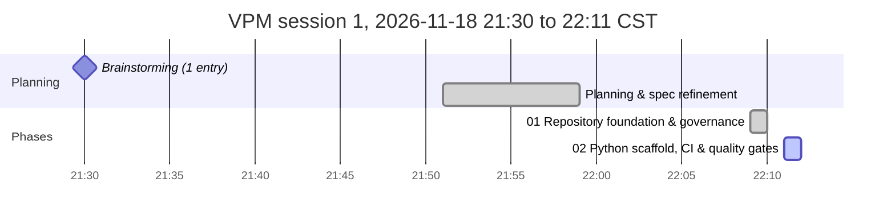

# VPM: VPN Monitor Implementation Plan

**Spec:** [`docs/VPM_SPECIFICATION.md`](docs/VPM_SPECIFICATION.md). **Decisions:** [`docs/VPM_DECISIONS.md`](docs/VPM_DECISIONS.md). **Agent rules:** [`CLAUDE.md`](CLAUDE.md). **Shared phase instructions:** [`prompts/VPM_shared-instructions.md`](prompts/VPM_shared-instructions.md)
**Last updated:** 2026-11-18 22:19 CST (Phase 02, Python scaffold)
**Brainstorm:** VPM_Brainstorming.md
The brainstorm is traced in the spec's Amendments ("Brainstorm trace") and drawn in the timeline's Planning lane.

> ⚠️ **Mandatory:** every agent that works on this project keeps this file accurate. **Before doing any other work, set your phase to `🔄 In progress` and commit that change to `main`** (claim protocol: `prompts/VPM_shared-instructions.md` §1a). Other agents read this table from `main`. At the end, set it to `✅ Complete` or `⛔ Blocked` and add a Phase Log entry. See `CLAUDE.md`.

## How to run a phase
Open Claude Code in `/home/nick/Work/VPNMonitor` and type one of:
- `/phase`: run the next eligible phase. It checks dependencies, tells you if you're on the wrong model, resumes an `In progress` phase, and asks about any open questions it needs.
- `/phase NN`: run a specific phase.
- `/phase status`: show progress and what's next, without doing any work.
- `/phase-add [after NN] <request or file>`: plan a new lettered phase (`07a`) from a change request. No product work, no claim.

**Optional hands-off runs (PhaseHypervisor):** `phx preflight /home/nick/Work/VPNMonitor` asks the foreseeable questions once, then `phx run /home/nick/Work/VPNMonitor` runs the remaining phases unattended through `/phase NN --auto`, honouring the Gate column. Manual `/phase` stays the standard way; you can switch between the two at any phase boundary, and `/phase` stops if a `phx` supervisor is running this plan.

The agent merges a completed phase into `main` and pushes it without asking (Nick's standing git authority); review its close-out summary.

Each phase is claimed by a `chore(plan): start phase NN` commit on `main` and runs in its own worktree, `../VPNMonitor-phase-NN`, so parallel sessions never share a checkout. `/phase status` flags any branch or worktree whose row is not `🔄 In progress`.

**Parallelism:** after Phase 03, Phases **04, 05 and 06** are independent (each builds against the Phase 02 interfaces and fakes) and can run in parallel sessions. Everything else is sequential. Phases 04 and 07 need Nick at the keyboard briefly (he toggles the VPN himself); Phase 06 needs his approval of the screenshots.

**Gate column** (read only by PhaseHypervisor; manual `/phase` ignores it): `auto` = may run unattended; `review` = pause for Nick after it; `owner` = Nick starts it. Empty means `auto`.

**Status values:** ⬜ Not started · 🔄 In progress · ⛔ Blocked · ✅ Complete. Always write the icon **and** the word.

## Phases

| Phase | Phase Name | Phase Purpose | AI Model to Use | Depends on | Status | Prompt to Initiate This Phase | Gate |
|---|---|---|---|---|---|---|---|
| 00 | Planning & spec refinement | Review source docs, resolve decisions, write the spec, plan and prompts | Claude Opus 5.5 | none | ✅ Complete | n/a (planning session) | owner |
| 01 | Repository foundation & governance | Governance files, docs skeleton, gitleaks, private GitHub repo | Claude Sonnet 5.5 (`/model sonnet`) | 00 | ✅ Complete | [`prompts/VPM_phase-01-repo-foundation.md`](prompts/VPM_phase-01-repo-foundation.md) | auto |
| 02 | Python scaffold, CI & quality gates | Package, shared types, Protocols, fakes, CLI stub, CI, architecture doc | Claude Sonnet 5.5 (`/model sonnet`) | 01 | ✅ Complete | [`prompts/VPM_phase-02-python-scaffold-ci.md`](prompts/VPM_phase-02-python-scaffold-ci.md) | auto |
| 03 | Core state engine | Pure decision engine (no false blue), browser matcher, config, event log | Claude Opus 5.5 (`/model opus`) | 02 | ⬜ Not started | [`prompts/VPM_phase-03-core-state-engine.md`](prompts/VPM_phase-03-core-state-engine.md) | auto |
| 04 | VPN route detector | Route probes per family, interface classifier, leak/fail-safe rules, change watcher | Claude Opus 5.5 (`/model opus`) | 03 | ⬜ Not started | [`prompts/VPM_phase-04-vpn-detector.md`](prompts/VPM_phase-04-vpn-detector.md) | auto |
| 05 | Hyprland focus watcher | socket2 events → FocusEvent (no titles), initial state, reconnect, real classes | Claude Sonnet 5.5 (`/model sonnet`) | 03 | ⬜ Not started | [`prompts/VPM_phase-05-hyprland-focus-watcher.md`](prompts/VPM_phase-05-hyprland-focus-watcher.md) | auto |
| 06 | Glow bar overlay | Click-through layer-shell red/blue glow bar, fades, multi-monitor, screenshots approved by Nick | Claude Opus 5.5 (`/model opus`) | 03 | ⬜ Not started | [`prompts/VPM_phase-06-glow-bar-overlay.md`](prompts/VPM_phase-06-glow-bar-overlay.md) | review |
| 07 | Daemon, service & install | Wiring, control socket, CLI, systemd user unit, pause keybinding, install/uninstall, OSMods | Claude Sonnet 5.5 (`/model sonnet`) | 04, 05, 06 | ⬜ Not started | [`prompts/VPM_phase-07-daemon-service-install.md`](prompts/VPM_phase-07-daemon-service-install.md) | review |
| 08 | Hardening, security & QA | Threat model, fault injection, scanners, measured performance, log hygiene, follow-ups | Claude Opus 5.5 (`/model opus`) | 07 | ⬜ Not started | [`prompts/VPM_phase-08-hardening-security-qa.md`](prompts/VPM_phase-08-hardening-security-qa.md) | auto |
| 09 | Release & publication | v1.0.0 tag, final report with timeline, publish only on Nick's yes | Claude Sonnet 5.5 (`/model sonnet`) | 08 | ⬜ Not started | [`prompts/VPM_phase-09-release-publication.md`](prompts/VPM_phase-09-release-publication.md) | review |

## Timeline
Generated by `scripts/phase_timeline.py` from the Phase Log and git; refreshed on `main` at every close-out, block, resume and `/phase-add`. Do not edit between the markers.

<!-- phase-timeline:start (generated by scripts/phase_timeline.py; do not edit) -->


*Generated from the Phase Log Timeline bullets and git, as of 2026-11-18 22:11 CST. ≈ marks a time inferred from git or a heading. Idle gaps over 60 min start a new chart below and are collapsed in the image. Regenerate with `python3 scripts/phase_timeline.py --write`; do not edit by hand.*



| Phase | Name | Started | Finished | Merged | Active | Blocked | Claim |
|---|---|---|---|---|---:|---:|---|
| brainstorm | Brainstorming (1 entry) | 2026-11-18 21:30 CST |  |  |  |  | n/a |
| 00 | Planning & spec refinement | 2026-11-18 21:51 CST | 21:59 |  | 8 m |  | n/a |
| 01 | Repository foundation & governance | 2026-11-18 22:09 CST | 22:10 | 22:10 | 1 m |  | `d547144` |
| 02 | Python scaffold, CI & quality gates | 2026-11-18 22:11 CST | (in progress) |  | < 1 m so far |  | `fb6aca4` |

**Totals:** elapsed 41 m (first recorded start to 2026-11-18 22:11 CST) · active phase time 1 m (sum over phases) · blocked or paused 0 m · idle 0 m in 0 gap(s) over 60 min.

**Not started:** 03, 04, 05, 06, 07, 08, 09.
<!-- phase-timeline:end -->

### Model rationale
- **Opus 5.5** where a subtle mistake would make the indicator lie or the desktop misbehave: **03** (the decision engine and its "never a false blue" invariant), **04** (route/policy-routing parsing and leak classification, security-critical), **06** (GTK4 layer-shell drawing, scaling, animation without idle redraws, click-through; complex interactive UI), **08** (security review and fault injection).
- **Sonnet 5.5** for well-specified work: **01** (governance files), **02** (scaffolding and CI), **05** (Hyprland's line protocol is simple and documented; the risky part, title stripping, is spelled out and tested), **07** (wiring against finished components, systemd unit, install scripts), **09** (release paperwork).
- Fable 5.2 is not needed for any phase: no phase needs deeper reasoning than Opus gives, and it costs more.

### Dependency graph
```
00 ─► 01 ─► 02 ─► 03 ─┬─► 04 (VPN detector) ──────┐
                      ├─► 05 (focus watcher) ─────┼─► 07 (daemon + install) ─► 08 (hardening) ─► 09 (release)
                      └─► 06 (overlay, review) ───┘
```
Parallel: 04 ∥ 05 ∥ 06.

### Definition of done (checked in the final phase)
- [ ] With a browser or Omarchy web app focused, the bottom edge of its monitor glows **blue** when internet routes leave via a VPN and **red** otherwise; no bar when a non-browser is focused.
- [ ] A VPN drop shows red within 2 s; a focus change updates the bar within 150 ms (measured).
- [ ] No false blue in any tested fault (unknown, stale, split-tunnel leak, watcher crash, suspend).
- [ ] Window titles never appear in logs or state; no external network calls (tests + log audit).
- [ ] Idle cost ~0 % CPU with no browser focused (measured).
- [ ] Runs at login as a systemd user service; pause/resume keybinding and CLI work; install/uninstall are clean and documented in OSMods.
- [ ] Nick approved the look (Phase 06 screenshots).
- [ ] All governance files present; CI green; tag `v1.0.0`; final report with generated timeline.
- [ ] Every brainstorm trace row is fulfilled or has a recorded disposition.
- [ ] Repo visibility and release state match Nick's recorded answer.

## Owner questions
| # | Question | Status / proposed default | Needed by |
|---|---|---|---|
| 1 | Pause/resume keybinding (SUPER+ALT+V is taken by Prometheus) | Open (asked 2026-11-18 21:58 CST, Phase 00). Proposed default: SUPER+ALT+SHIFT+V | Phase 07 |
| 2 | Exact look: thickness, glow, red and blue shades | Open (asked 2026-11-18 21:58 CST, Phase 00). Proposed default: 3 px core + 12 px glow, `#FF3B30` / `#0A84FF`; decided at the Phase 06 screenshot review | Phase 06 |
| 3 | Show the bar over a fullscreen browser (videos)? | Open (asked 2026-11-18 21:58 CST, Phase 00). Proposed default: yes | Phase 06 |
| 4 | How long does a pause last? | Open (asked 2026-11-18 21:58 CST, Phase 00). Proposed default: until resumed or next login | Phase 07 |
| 5 | Add DNS-leak detection? | Deferred (2026-11-18 21:58 CST): out of this plan; add later with `/phase-add` if wanted | none |
| 6 | Make the GitHub repo public and/or publish a release? | Open (asked 2026-11-18 21:58 CST, Phase 00). Proposed default: stays private, no release | Phase 09 |

## Phase Log
Newest entries at the bottom. Format: `### YYYY-MM-DD HH:MM TZ: Phase NN: <title> (<status>)` (timestamp from `date '+%Y-%m-%d %H:%M %Z'`, never a bare date). **The first bullet is always the Timeline:** `- **Timeline:** started <TS> (claim commit <hash>) · finished <TS> · merged <TS | not merged yet>` (add ` · blocked <TS> to <TS>` per `⛔` interval; *started* is the claim commit's time). Then bullets: built, deviations, follow-ups, tests.

### 2026-11-18 21:59 CST: Phase 00: Planning & spec refinement (✅ Complete)
- **Timeline:** started 2026-11-18 21:51 CST · finished 2026-11-18 21:59 CST
- **Brainstorm:** `VPM_Brainstorming.md`, 1 entry from 2026-11-18 21:30 CST to 2026-11-18 21:30 CST; 6 adopted, 0 deferred, 0 dropped (spec Amendments, "Brainstorm trace"); covered through 2026-11-18 21:30 CST.
- Read the brainstorm in full and inspected the machine (Hyprland 0.56.2 Lua config, ProtonVPN WireGuard `proton0` with policy routing and IPv6 leak guard, Tailscale, Brave/Chromium, gtk4-layer-shell, Python 3.14.8, existing keybindings). Feasibility confirmed: yes (spec R1).
- Owner decisions (one round): red/blue steady glow while a browser is focused; VPN = traffic actually routed via a VPN; browsers include Omarchy web apps; always-on user service with a pause key. Prefix `VPM` taken from the brainstorm file name.
- Refinements: pure engine with fail-safe red (R2, R4), per-family route probes with leak detection (R3), event-driven detection with re-check only while a browser is focused (R5), privacy baseline (no titles, no network calls), performance budget (R13).
- Found: SUPER+ALT+V is already bound (Prometheus), so the pause key default is SUPER+ALT+SHIFT+V (owner question 1).
- Wrote: spec with Amendments and brainstorm trace, ADR-0001…0010, this plan with 9 phases, shared instructions, phase prompts, `CLAUDE.md`, `/phase` and `/phase-add`, change-request template, vault note `02 Projects/VPM Implementation Plan.md`, timeline generator.
- Timeline tooling workarounds (skill bugs, reported to Nick, not fixed in PhaseHypervisor): the plan template's `**Brainstorm:**` line had trailing text that `phase_timeline.py` read as part of the file name, so the description moved to its own line; the brainstorm stamp had no zone and was read as UTC, so ` CST` was added to its single header line in `VPM_Brainstorming.md`.
- Tests: none (planning only).

### 2026-11-18 22:10 CST: Phase 01: Repository foundation & governance (✅ Complete)
- **Timeline:** started 2026-11-18 22:09 CST (claim commit d547144) · finished 2026-11-18 22:10 CST · merged 2026-11-18 22:10 CST
- **Model:** ran as Claude Sonnet 5.5 (plan lists Sonnet 5.5)
- **Built:** `LICENSE` (MIT), `NOTICE`, `README.md`, `SECURITY.md`, `CONTRIBUTING.md`, `CODE_OF_CONDUCT.md` (Contributor Covenant 2.1), `CHANGELOG.md`, `THIRD_PARTY_NOTICES.md` (licences read from `pacman -Qi`: gtk4 LGPL-2.1-or-later, gtk4-layer-shell MIT, python-gobject LGPL-2.1-or-later), `.gitignore` (extended the existing file), `.dockerignore`, `.editorconfig`, `.github/` (bug and feature templates, PR template, Dependabot for github-actions), `docs/README.md`, `docs/screenshots/.gitkeep`, `.pre-commit-config.yaml` (gitleaks v8.30.1, pre-commit-hooks v6.0.0, both verified as latest releases).
- **Deviations:** the Phase 01 prompt named the copyright holder "Nick Antoncic"; the git identity and GitHub account say "Nick Antonizick", so the licence and notice use that spelling (treated as a typo in the prompt). The `end-of-file-fixer` hook excludes `VPM_Brainstorming.md` (owner's source file, left byte-for-byte unchanged); it added a final newline to `prompts/VPM_shared-instructions.md`.
- **Follow-ups:** Phase 02 adds the pip/uv Dependabot entry, CI, and dev-tool licences in THIRD_PARTY_NOTICES; CONTRIBUTING setup commands are placeholders until then.
- **Tests:** `pre-commit run --all-files` passes (gitleaks finds nothing); no `{{` template markers in governance files. No code, so no pytest.

### 2026-11-18 22:19 CST: Phase 02: Python scaffold, CI & quality gates (✅ Complete)
- **Timeline:** started 2026-11-18 22:11 CST (claim commit fb6aca4) · finished 2026-11-18 22:19 CST · merged 2026-11-18 22:19 CST
- **Model:** ran as Claude Sonnet 5.5 (plan lists Sonnet 5.5)
- **Built:** `pyproject.toml` (hatchling, no runtime deps, dev group pytest/pytest-cov/ruff/mypy locked in `uv.lock`, ruff + `mypy --strict` on `src/`, `gi`/`wayland` markers); `src/vpn_monitor/` with `model.py` (frozen types, no title field anywhere, `FocusSource`/`VpnSource`/`IndicatorSink` Protocols), stubs for engine (shaped as the Phase 03 `Engine` class), browsers, config, eventlog, vpn, focus, overlay, control, daemon, `fakes.py`, `cli.py` (spec R10 subcommands, stubs exit 2) and `__main__.py`; tests (20 pass: model immutability and no-title, CLI, fakes, Protocol conformance) with a `conftest.py` that skips `gi`/`wayland` tests; `.github/workflows/ci.yml` (Python 3.12 + 3.14, actions pinned by SHA) and a Dependabot `uv` entry; `docs/VPM_ARCHITECTURE.md`; CONTRIBUTING setup, README, CHANGELOG, THIRD_PARTY_NOTICES (dev licences), CLAUDE.md test line confirmed.
- **ADRs:** ADR-0006 verified and Accepted (`gi` + `Gtk4LayerShell` import without `LD_PRELOAD`; library `/usr/lib/libgtk4-layer-shell.so`); new ADR-0011 (callback-style Protocols) and ADR-0012 (single GLib main loop).
- **Findings:** `uv` picks a uv-managed Python 3.13 that cannot import the system `gi`, so `[tool.uv] python-preference = "only-system"` is set; CI overrides it with `UV_PYTHON_PREFERENCE=managed`. `ruff format` would rewrite `scripts/phase_timeline.py` (copied from the skill), so it is excluded from ruff. `pre-commit` is not run in CI (documented in CONTRIBUTING).
- **Deviations:** acceptance item "CI run green on GitHub" is **not met**: GitHub Actions refuses to start jobs ("recent account payments have failed or your spending limit needs to be increased", run https://github.com/antonizick/VPNMonitor/actions/runs/44457085826). Nick chose to close the phase with CI deferred. The CI recipe was verified locally instead: `uv sync --frozen --python 3.12` on a managed interpreter, then mypy and pytest pass (3.12.15 and system 3.14.8). The workflow also triggers on `phase-*` branches.
- **Follow-ups:** fix GitHub billing, then re-run the CI workflow on `main` and record the result; adding a Phase 08 check that CI is green before release.
- **Tests:** `uv run ruff check . && uv run ruff format --check . && uv run mypy src && uv run pytest` all pass locally (20 passed); `pre-commit run --all-files` passes.
