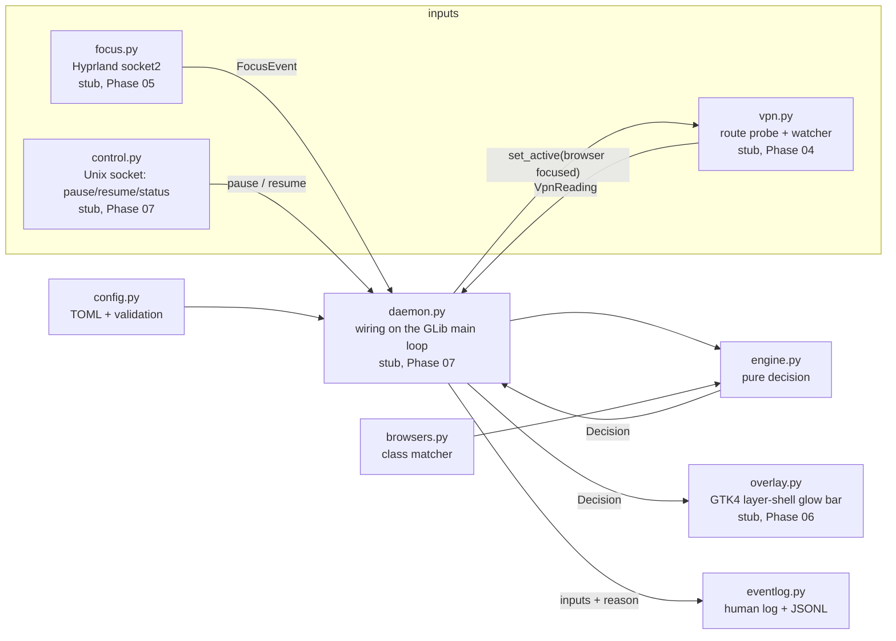

# VPM: Architecture

Status as of Phase 03 (2026-11-18 22:29 CST): types, fakes, the pure engine, browser matcher, config and event log are built; every module marked *stub* raises `NotImplementedError` until the phase named. Keep this file in sync as phases land.

## Components



The daemon (`daemon.py`) owns the wiring; the engine is a pure function of its inputs and never does I/O (spec R2). Every module talks to the others only through the types in `model.py`.

## Data types (`model.py`)
All are frozen dataclasses or enums. **No type carries a window title** (spec S1); a test asserts it.

| Type | Purpose |
|---|---|
| `FocusEvent` | window class, address, monitor name, fullscreen flag |
| `MonitorInfo` | name, logical size, scale, focused flag |
| `VpnState` | `VPN` / `NO_VPN` / `UNKNOWN` (unknown renders red) |
| `RouteKind` | `ROUTED` / `BLOCKED` / `UNREACHABLE` / `ERROR` |
| `FamilyRoute` | per address family: probe destination, egress interface, kind, `is_vpn` |
| `VpnReading` | state, per-family routes, reason, monotonic timestamp |
| `Indicator` | `HIDDEN` / `RED` / `BLUE` |
| `Decision` | indicator, monitor, reason, flat `inputs` record for the log |

## Interfaces (Protocols in `model.py`, ADR-0011)
```
FocusSource.start(callback: (FocusEvent) -> None); stop()
VpnSource.start(callback: (VpnReading) -> None); stop(); set_active(bool)
IndicatorSink.apply(Decision); close()
```
`start` also delivers the initial state. `fakes.py` has `FakeFocusSource`, `FakeVpnSource` and `RecordingSink`, so everything above the I/O modules is testable without GLib, Wayland or a VPN.

## Event loop and threading (ADR-0012)
One GLib main loop on the main thread. Watchers are integrated with `GLib.io_add_watch` (Hyprland socket, subprocess pipes), `GLib.timeout_add` (periodic re-check, only while a browser is focused) and `Gio` (NetworkManager signals if used). Their callbacks run on the main thread, so the engine and overlay need no locks. A probe that could block has a timeout and falls back to an UNKNOWN reading. Idle cost is zero: nothing is scheduled while no browser is focused (spec R13).

## Engine (`engine.py`, ADR-0013)
`Engine(matcher, clock, max_reading_age_s=10, blue_confirm_ms=0, show_on_fullscreen=True)` or `Engine.from_config(config, time.monotonic)`. Inputs: `on_focus(FocusEvent)`, `on_vpn(VpnReading)`, `on_pause(bool)`, `on_monitors(list[MonitorInfo])`, `tick(now=None)`. Each returns the new `Decision` only when `(indicator, monitor, reason)` changed, else `None`. Read-only: `decision`, `active` (a bar is shown, so VPN re-checks are wanted), `paused`, `next_deadline()` (monotonic time at which `tick` may change the decision; `None` while idle). The clock is injected and `VpnReading.timestamp` must use the same monotonic clock.

Rules, first match wins:

| # | Condition | Indicator | Reason (exact text) |
|---|---|---|---|
| 1 | paused | HIDDEN | `paused` |
| 2 | no focus event, or empty class | HIDDEN | `no window focused` |
| 3 | class does not match the browser list | HIDDEN | `focused window is not a browser` |
| 4 | fullscreen and `show_on_fullscreen = false` | HIDDEN | `fullscreen browser and show_on_fullscreen is off` |
| 5 | no monitor resolvable | HIDDEN | `monitor of the focused browser is unknown` |
| 6 | no reading yet | RED | `browser focused, no VPN reading yet` |
| 7 | reading `UNKNOWN` | RED | `browser focused, VPN state unknown` |
| 8 | reading `NO_VPN` | RED | `browser focused, traffic is not routed through a VPN` |
| 9 | timestamp NaN or > 1 s in the future | RED | `browser focused, VPN reading has an invalid timestamp` |
| 10 | age > `max_reading_age_s` | RED | `browser focused, VPN reading is stale` |
| 11 | `VPN` but routes disagree (no family routed via VPN, a family routed outside a VPN, or a probe `ERROR`) | RED | `browser focused, VPN reading contradicts its routes` |
| 12 | positive for less than `blue_confirm_ms` | RED | `browser focused, VPN confirmation pending` |
| 13 | otherwise | BLUE | `browser focused, routed through a VPN` |

Monitor: the focused window's monitor; if empty or not in the monitor list, the monitor flagged focused, else the first known one. A HIDDEN decision has `monitor == ""`. Rows 6–12 all go through `reading_problem()`, the single gate for blue. Invariant, tested over every combination of inputs and 200 random event sequences: **BLUE ⇒ browser focused ∧ not paused ∧ fresh, route-consistent `VPN` reading** (spec S6). Red is never delayed.

`Decision.inputs` (flat `str -> str`): `class`, `match` (`exact:<class>`, `regex:<pattern>` or `none`), `monitor`, `fullscreen`, `paused`, `vpn_state` (`vpn`/`no_vpn`/`unknown`/`none`), `reading_age_s`, `routes` (e.g. `v4 proton0 routed vpn; v6 ipv6leakintrf0 blocked`), `reading_reason`.

## Browser matcher (`browsers.py`, ADR-0004)
`BrowserMatcher(classes, patterns).match(cls) -> MatchResult(matched, rule)`. Exact classes are case-sensitive; patterns are regexes matched with `re.fullmatch`. Defaults: the full browsers in `DEFAULT_CLASSES` plus `^(brave|chrome|chromium|msedge)-.+__.*$` for Omarchy web apps (Chromium-family `--app` windows such as `brave-basecamp.com__-Default`).

## Configuration (`config.py`)
`load_config(path=None) -> Config` reads `$XDG_CONFIG_HOME/vpn-monitor/config.toml` (default `~/.config/vpn-monitor/config.toml`); a missing file gives the defaults. `Config` is frozen, with sections `browsers`, `probes`, `vpn`, `indicator`, `appearance`, `pause`, `log`; every default lives in code, and `config/config.example.toml` documents every key with the same values (a test checks equality). Unknown keys or sections land in `Config.warnings` (the daemon logs them); a wrong type or value raises `ConfigError` whose message starts with the dotted key. Cross-field rules: `probe_timeout_s < recheck_interval_s < max_reading_age_s`; `indicator.red_confirm_ms` must be 0.

## Fail-safe
Any exception, timeout or stale reading in a VPN path becomes `VpnReading(state=UNKNOWN, reason=...)`, which the engine renders red. Blue requires a fresh `VPN` reading whose routes agree with it (spec R4/S6).

## Logging (`eventlog.py`, ADR-0014)
Every decision change and every error goes to both logs with its inputs and reason (spec R11). `EventLog(state_dir=None, max_bytes=1_000_000, backup_count=3, guard=None)` writes to `$XDG_STATE_HOME/vpn-monitor/` (default `~/.local/state/vpn-monitor/`, directory 0700): `vpn-monitor.log` (human) and `events.jsonl`, each size-rotated. Methods: `decision(Decision)`, `record(event, reason=…, decision=None, inputs=None, level=INFO)`, `error(event, reason, inputs)`, `close()`.

JSONL schema, one object per line:

| Key | Type | Meaning |
|---|---|---|
| `ts` | string | wall clock, ISO 8601 with UTC offset, milliseconds |
| `event` | string | `decision`, `reading`, `focus`, `pause`, `config`, `error`, … |
| `level` | string | `debug` / `info` / `warning` / `error` |
| `decision` | string or null | `hidden` / `red` / `blue` |
| `monitor` | string or null | monitor that shows the bar (`""` when hidden) |
| `reason` | string | why (engine reason text or the event's own) |
| `inputs` | object | flat `str -> str`; for decisions the engine inputs above |

Human line: `<ts> <LEVEL> <event> [<decision> [on <monitor>]]: <reason> [k=v …]`. `TitleGuard(titles)` raises `TitleLeakError` before writing if any string in a record contains a registered title (S1); tests feed it the titles they put into fake events.

## Repository layout
See `prompts/VPM_shared-instructions.md` §2. Source is in `src/vpn_monitor/`, tests in `tests/` (`gi` and `wayland` markers skip automatically; see `tests/conftest.py`).

## Build and CI
`pyproject.toml` (hatchling, no runtime dependencies, dev group pinned in `uv.lock`). Locally `uv` uses the system interpreter so `gi` is importable (ADR-0006); `.github/workflows/ci.yml` runs ruff, mypy and pytest on Python 3.12 and 3.14 with managed interpreters, where `gi` tests skip.
