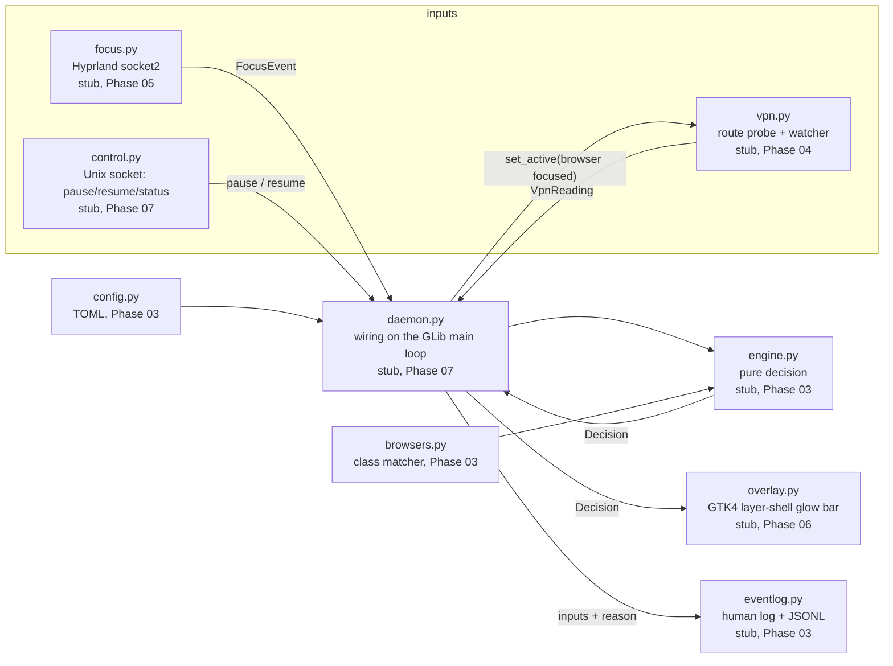

# VPM: Architecture

Status as of Phase 02 (2026-11-18 22:19 CST): interfaces, types and fakes exist; every module marked *stub* raises `NotImplementedError` until the phase named. Keep this file in sync as phases land.

## Components



The daemon (`daemon.py`) owns the wiring; the engine is a pure function of its inputs and never does I/O (spec R2). Every module talks to the others only through the types in `model.py`.

## Data types (`model.py`)
All are frozen dataclasses or enums. **No type carries a window title** (spec S1); a test asserts it.

| Type | Purpose |
|---|---|
| `FocusEvent` | window class, address, monitor name, fullscreen flag |
| `MonitorInfo` | name, logical size, scale, focused flag |
| `VpnState` | `VPN` / `NO_VPN` / `UNKNOWN` (unknown renders red) |
| `RouteKind` | `ROUTED` / `BLOCKED` / `UNREACHABLE` / `ERROR` |
| `FamilyRoute` | per address family: probe destination, egress interface, kind, `is_vpn` |
| `VpnReading` | state, per-family routes, reason, monotonic timestamp |
| `Indicator` | `HIDDEN` / `RED` / `BLUE` |
| `Decision` | indicator, monitor, reason, flat `inputs` record for the log |

## Interfaces (Protocols in `model.py`, ADR-0011)
```
FocusSource.start(callback: (FocusEvent) -> None); stop()
VpnSource.start(callback: (VpnReading) -> None); stop(); set_active(bool)
IndicatorSink.apply(Decision); close()
```
`start` also delivers the initial state. `fakes.py` has `FakeFocusSource`, `FakeVpnSource` and `RecordingSink`, so everything above the I/O modules is testable without GLib, Wayland or a VPN.

## Event loop and threading (ADR-0012)
One GLib main loop on the main thread. Watchers are integrated with `GLib.io_add_watch` (Hyprland socket, subprocess pipes), `GLib.timeout_add` (periodic re-check, only while a browser is focused) and `Gio` (NetworkManager signals if used). Their callbacks run on the main thread, so the engine and overlay need no locks. A probe that could block has a timeout and falls back to an UNKNOWN reading. Idle cost is zero: nothing is scheduled while no browser is focused (spec R13).

## Fail-safe
Any exception, timeout or stale reading in a VPN path becomes `VpnReading(state=UNKNOWN, reason=...)`, which the engine renders red. Blue requires a fresh `VPN` reading (spec R4/S6).

## Logging
Every decision change and every error goes to the human log and the JSONL event log with its inputs and reason (spec R11); `eventlog.py` is built in Phase 03.

## Repository layout
See `prompts/VPM_shared-instructions.md` §2. Source is in `src/vpn_monitor/`, tests in `tests/` (`gi` and `wayland` markers skip automatically; see `tests/conftest.py`).

## Build and CI
`pyproject.toml` (hatchling, no runtime dependencies, dev group pinned in `uv.lock`). Locally `uv` uses the system interpreter so `gi` is importable (ADR-0006); `.github/workflows/ci.yml` runs ruff, mypy and pytest on Python 3.12 and 3.14 with managed interpreters, where `gi` tests skip.
