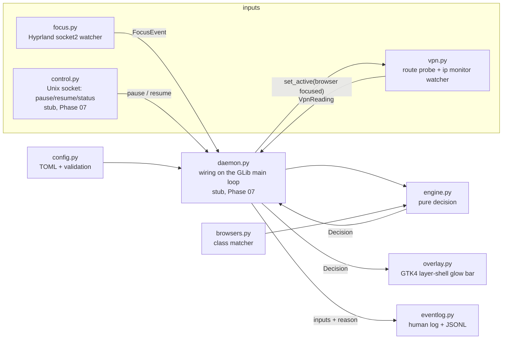

# VPM: Architecture

Status as of Phase 06 (2026-11-19 09:18 CST): types, fakes, the pure engine, browser matcher, config, event log, VPN detector, focus watcher and glow-bar overlay are built; every module marked *stub* raises `NotImplementedError` until the phase named. Keep this file in sync as phases land.

## Components



The daemon (`daemon.py`) owns the wiring; the engine is a pure function of its inputs and never does I/O (spec R2). Every module talks to the others only through the types in `model.py`.

## Data types (`model.py`)
All are frozen dataclasses or enums. **No type carries a window title** (spec S1); a test asserts it.

| Type | Purpose |
|---|---|
| `FocusEvent` | window class, address, monitor name, fullscreen flag |
| `MonitorInfo` | name, logical size, scale, focused flag |
| `VpnState` | `VPN` / `NO_VPN` / `UNKNOWN` (unknown renders red) |
| `RouteKind` | `ROUTED` / `BLOCKED` / `UNREACHABLE` / `ERROR` |
| `FamilyRoute` | per address family: probe destination, egress interface, kind, `is_vpn` |
| `VpnReading` | state, per-family routes, reason, monotonic timestamp |
| `Indicator` | `HIDDEN` / `RED` / `BLUE` |
| `Decision` | indicator, monitor, reason, flat `inputs` record for the log |

## Interfaces (Protocols in `model.py`, ADR-0011)
```
FocusSource.start(callback: (FocusEvent) -> None); stop()
VpnSource.start(callback: (VpnReading) -> None); stop(); set_active(bool)
IndicatorSink.apply(Decision); close()
```
`start` also delivers the initial state. `fakes.py` has `FakeFocusSource`, `FakeVpnSource` and `RecordingSink`, so everything above the I/O modules is testable without GLib, Wayland or a VPN.

## Event loop and threading (ADR-0012)
One GLib main loop on the main thread. Watchers are integrated with `GLib.io_add_watch` (Hyprland socket, subprocess pipes), `GLib.timeout_add` (periodic re-check, only while a browser is focused) and `Gio` (NetworkManager signals if used). Their callbacks run on the main thread, so the engine and overlay need no locks. A probe that could block has a timeout and falls back to an UNKNOWN reading. Idle cost is zero: nothing is scheduled while no browser is focused (spec R13).

## Engine (`engine.py`, ADR-0013)
`Engine(matcher, clock, max_reading_age_s=10, blue_confirm_ms=0, show_on_fullscreen=True)` or `Engine.from_config(config, time.monotonic)`. Inputs: `on_focus(FocusEvent)`, `on_vpn(VpnReading)`, `on_pause(bool)`, `on_monitors(list[MonitorInfo])`, `tick(now=None)`. Each returns the new `Decision` only when `(indicator, monitor, reason)` changed, else `None`. Read-only: `decision`, `active` (a bar is shown, so VPN re-checks are wanted), `paused`, `next_deadline()` (monotonic time at which `tick` may change the decision; `None` while idle). The clock is injected and `VpnReading.timestamp` must use the same monotonic clock.

Rules, first match wins:

| # | Condition | Indicator | Reason (exact text) |
|---|---|---|---|
| 1 | paused | HIDDEN | `paused` |
| 2 | no focus event, or empty class | HIDDEN | `no window focused` |
| 3 | class does not match the browser list | HIDDEN | `focused window is not a browser` |
| 4 | fullscreen and `show_on_fullscreen = false` | HIDDEN | `fullscreen browser and show_on_fullscreen is off` |
| 5 | no monitor resolvable | HIDDEN | `monitor of the focused browser is unknown` |
| 6 | no reading yet | RED | `browser focused, no VPN reading yet` |
| 7 | reading `UNKNOWN` | RED | `browser focused, VPN state unknown` |
| 8 | reading `NO_VPN` | RED | `browser focused, traffic is not routed through a VPN` |
| 9 | timestamp NaN or > 1 s in the future | RED | `browser focused, VPN reading has an invalid timestamp` |
| 10 | age > `max_reading_age_s` | RED | `browser focused, VPN reading is stale` |
| 11 | `VPN` but routes disagree (no family routed via VPN, a family routed outside a VPN, or a probe `ERROR`) | RED | `browser focused, VPN reading contradicts its routes` |
| 12 | positive for less than `blue_confirm_ms` | RED | `browser focused, VPN confirmation pending` |
| 13 | otherwise | BLUE | `browser focused, routed through a VPN` |

Monitor: the focused window's monitor; if empty or not in the monitor list, the monitor flagged focused, else the first known one. A HIDDEN decision has `monitor == ""`. Rows 6–12 all go through `reading_problem()`, the single gate for blue. Invariant, tested over every combination of inputs and 200 random event sequences: **BLUE ⇒ browser focused ∧ not paused ∧ fresh, route-consistent `VPN` reading** (spec S6). Red is never delayed.

`Decision.inputs` (flat `str -> str`): `class`, `match` (`exact:<class>`, `regex:<pattern>` or `none`), `monitor`, `fullscreen`, `paused`, `vpn_state` (`vpn`/`no_vpn`/`unknown`/`none`), `reading_age_s`, `routes` (e.g. `v4 proton0 routed vpn; v6 ipv6leakintrf0 blocked`), `reading_reason`.

## Focus watcher (`focus.py`, ADR-0016)
`FocusWatcher(scheduler, spawner=…, query=…, clock=…, log=…)` is the daemon's `FocusSource`. `start` delivers "no focus" (`FocusEvent("", "", "")`, the engine hides the bar), connects to `.socket2.sock`, reads the initial state and delivers it. Hyprland's socket paths come from `$XDG_RUNTIME_DIR/hypr/$HYPRLAND_INSTANCE_SIGNATURE`, else the newest live instance there (`locate_sockets`; `HyprlandNotRunning` if none). Events are read through `Scheduler.watch_fd`, split on newlines (a line over 64 KiB is discarded, never buffered), parsed by `parse_event_line`, and a burst that contains any relevant event triggers **one** `j/activewindow` request. A `FocusEvent` is delivered only when it differs from the last one. Stream closed or unreadable: "no focus" at once, reconnect after 0.1 s doubling to 5 s (reset after a 10 s connection), initial state re-read on success. A failed request also hides the bar and reconnects. Errors are logged once per distinct reason; every focus change is logged as a `focus` event (class, monitor, fullscreen, trigger, never a title).

| Event | Used for |
|---|---|
| `activewindow>>class,title` | refresh trigger; only the text before the first comma is kept, the title is dropped in the parser |
| `activewindowv2>>address` | refresh trigger (address gets its `0x` prefix) |
| `focusedmon`, `focusedmonv2`, `fullscreen`, `closewindow`, `movewindow`, `movewindowv2` | refresh trigger |
| `monitoradded`, `monitoraddedv2`, `monitorremoved`, `monitorremovedv2` | refresh trigger, and the monitor id → name table is dropped |
| `windowtitle`, `windowtitlev2`, `openwindow`, everything else | name only; no data kept, no refresh |

The request side (`HyprlandClient`) asks `j/activewindow` and `j/monitors` (id → name, cached) over `.socket.sock`. Only `class`, `address`, `monitor` and `fullscreen` (bit 2 of the mode) are read; `title` and `initialTitle` are never copied. `vpn-monitor focus [--watch] [--json] [--log]` prints class, matched rule and monitor (exit 0 browser, 1 other, 2 no Hyprland or bad config). Observed classes are in `tests/fixtures/focus/classes.json`.

## Browser matcher (`browsers.py`, ADR-0004)
`BrowserMatcher(classes, patterns).match(cls) -> MatchResult(matched, rule)`. Exact classes are case-sensitive; patterns are regexes matched with `re.fullmatch`. Defaults: the full browsers in `DEFAULT_CLASSES` plus `^(brave|chrome|chromium|msedge)-.+__.*$` for Omarchy web apps (Chromium-family `--app` windows such as `brave-basecamp.com__-Default`).

## Configuration (`config.py`)
`load_config(path=None) -> Config` reads `$XDG_CONFIG_HOME/vpn-monitor/config.toml` (default `~/.config/vpn-monitor/config.toml`); a missing file gives the defaults. `Config` is frozen, with sections `browsers`, `probes`, `vpn`, `indicator`, `appearance`, `pause`, `log`; every default lives in code, and `config/config.example.toml` documents every key with the same values (a test checks equality). Unknown keys or sections land in `Config.warnings` (the daemon logs them); a wrong type or value raises `ConfigError` whose message starts with the dotted key. Cross-field rules: `probe_timeout_s < recheck_interval_s < max_reading_age_s`; `indicator.red_confirm_ms` must be 0.

## Fail-safe
Any exception, timeout or stale reading in a VPN path becomes `VpnReading(state=UNKNOWN, reason=...)`, which the engine renders red. Blue requires a fresh `VPN` reading whose routes agree with it (spec R4/S6).

## VPN detector (`vpn.py`, ADR-0003, ADR-0007, ADR-0015)
**Probe.** For each family, `ip -4|-6 -j route get <probe>` (defaults `1.1.1.1`, `2606:4700:4700::1111`; fixed argv, no shell, `LC_ALL=C`, `vpn.probe_timeout_s`). The kernel returns the route the current user's traffic would take, honouring policy rules, fwmarks and uid rules; no packet is sent (S2). The reading's timestamp is taken *before* probing (`time.monotonic`), so it is never younger than the data. The three `ip` calls take about 12 ms on the reference machine.

**Per-family result.**

| Kernel answer | `RouteKind` | `is_vpn` |
|---|---|---|
| unicast route via a `wireguard` or `tun` device, or a name matching `vpn.interface_patterns` | `ROUTED` | true |
| unicast route via a `dummy` device or a name matching `vpn.leak_guard_interfaces` | `BLOCKED` | false |
| unicast route via any other device (Wi-Fi, Ethernet, bridge, `sit`/`gre` tunnels…) | `ROUTED` | false (a leak) |
| route type `blackhole` / `prohibit`, or the error "Permission denied" (IPv4 prohibit) | `BLOCKED` | false |
| route type `unreachable`, or the errors "Network is unreachable", "No route to host", "Address family not supported" | `UNREACHABLE` | false |
| `ip` missing, timeout, other exit status or error, non-JSON or empty output, no `dev`, another route type | `ERROR` | false |

Link kinds come from `ip -d -j link show` (`linkinfo.info_kind`), cached, dropped on every change burst and reloaded for any unknown interface; if they cannot be read, only the name globs apply.

**Verdict (spec R3).** In order: any family `ROUTED` outside a VPN → `NO_VPN` (the reason names the leaking family and interface); any `ERROR` → `UNKNOWN`; no family `ROUTED` (all blocked or unreachable: kill switch engaged, no network) → `NO_VPN`; otherwise `VPN`. A crash anywhere in the probe → `UNKNOWN`. A test checks over all 25 per-family combinations that `state is VPN` exactly when the engine's `reading_problem()` allows blue.

**Watcher (`RouteWatcher`, the `VpnSource`).** Driven by a `mainloop.Scheduler` (`GLibScheduler` in the daemon, `fakes.FakeScheduler` in tests):

| Trigger | Action |
|---|---|
| `start(callback)` | spawn `ip monitor route rule link`, probe at once |
| any output line | drop the link cache; if no probe is pending, probe in 200 ms (`DEBOUNCE_S`); `last_latency_s` = time from the burst's first line to the reading |
| `set_active(True)` | probe at once, then every `vpn.recheck_interval_s` (each probe restarts the interval) |
| `set_active(False)` | cancel the re-check: no timers while no browser is focused |
| monitor exits / read error / cannot start | log an error, restart after 0.5 s, doubling to 30 s (reset after a 30 s run); after it has run 1 s or delivered a line, log "running again" and re-probe |
| monitor down > `vpn.max_reading_age_s` | a `VPN` reading is delivered as `UNKNOWN` (red); negative readings pass through |

Readings are logged as `reading` events when their state or reason changes (inputs: `vpn_state`, `routes`, `trigger`, `latency_ms`); watcher failures as `vpn_watcher` errors. Measured on the reference machine (Phase 04): ProtonVPN disconnect → `NO_VPN` 228 ms after the first route event; reconnect → `VPN` 222 ms after it.

`vpn-monitor probe [--json] [--watch [--log]] [--config PATH]` prints the reading (exit 0 VPN, 1 not through a VPN, 3 unknown, 2 config error); `--watch` runs the watcher on a GLib loop and prints every change with its trigger and reaction time.

## Overlay (`overlay.py`, ADR-0017)
`GlowOverlay(appearance, backend=None, log=None, clock=time.monotonic, on_settled=None)` is the `IndicatorSink`. Three layers:

| Layer | What | Tested by |
|---|---|---|
| Pure helpers | `parse_colour`, `bar_height`, `snap_to_device` (core on whole device pixels), `glow_stops` (alpha `0.55 · (1 − t)^2.2`), `ease` (smoothstep), `Look` (resolved `[appearance]`), `Fade` (colour + opacity animator, time injected) | unit tests |
| `Bar` | per-monitor state machine: HIDDEN → fading in → shown → cross-fading → fading out → unmapped. Drives a `BarSurface` (`map`, `unmap`, `queue_draw`, `start_ticks`, `destroy`); counts `draws` and `idle_draws` | fake surface + fake frame clock |
| `Backend` / `GtkBackend` | creates `GtkSurface`s (one `Gtk.Window` + `Gtk.DrawingArea` per monitor) and reports monitors from `Gdk.Display.get_monitors()` `items-changed` | `wayland`-marked subprocess test |

Surface: layer `OVERLAY`, anchors bottom/left/right, exclusive zone 0, keyboard mode NONE, namespace `vpn-monitor`, empty input region (set on every `map`), height `thickness + glow` logical px. Only the monitor a Decision names gets a window (created on first use); other bars fade out and unmap. `apply` is idempotent. Monitor removed: its bar is destroyed; the Decision's monitor coming back gets its bar again. Any toolkit exception is logged as `overlay_error` and swallowed (S4).

Animation: `fade_ms` smoothstep; the frame-clock tick callback exists only while a fade runs, so a settled bar does nothing (R13). The fade's clock starts at the first frame after a map (the first map is slow). Events: `overlay` (indicator change, info), `overlay_settled` (debug, with the draw count), `overlay_monitor`, `overlay_monitor_missing`, `overlay_error`.

Process setup: `ensure_layer_shell(argv)` re-execs once with `LD_PRELOAD=libgtk4-layer-shell.so` (guard `VPN_MONITOR_PRELOADED`) and must run before Gtk is imported; `GtkBackend` sets `GSK_RENDERER=cairo` unless already set and raises `RuntimeError` if layer shell is unavailable. `vpn-monitor preview red|blue|cycle [--seconds N] [--monitor M] [--backdrop] [--log] [--config]` drives the overlay directly; `scripts/preview.sh [MONITOR]` takes the review screenshots.

Measured on the reference machine (bar shown, after the fade): 0 idle redraws, 0 CPU ticks over 20 s, RSS 105 MB / PSS 58 MB, 6 threads; about 10 draws per fade at 60 Hz.

## Logging (`eventlog.py`, ADR-0014)
Every decision change and every error goes to both logs with its inputs and reason (spec R11). `EventLog(state_dir=None, max_bytes=1_000_000, backup_count=3, guard=None)` writes to `$XDG_STATE_HOME/vpn-monitor/` (default `~/.local/state/vpn-monitor/`, directory 0700): `vpn-monitor.log` (human) and `events.jsonl`, each size-rotated. Methods: `decision(Decision)`, `record(event, reason=…, decision=None, inputs=None, level=INFO)`, `error(event, reason, inputs)`, `close()`.

JSONL schema, one object per line:

| Key | Type | Meaning |
|---|---|---|
| `ts` | string | wall clock, ISO 8601 with UTC offset, milliseconds |
| `event` | string | `decision`, `reading`, `focus`, `pause`, `config`, `error`, … |
| `level` | string | `debug` / `info` / `warning` / `error` |
| `decision` | string or null | `hidden` / `red` / `blue` |
| `monitor` | string or null | monitor that shows the bar (`""` when hidden) |
| `reason` | string | why (engine reason text or the event's own) |
| `inputs` | object | flat `str -> str`; for decisions the engine inputs above |

Human line: `<ts> <LEVEL> <event> [<decision> [on <monitor>]]: <reason> [k=v …]`. `TitleGuard(titles)` raises `TitleLeakError` before writing if any string in a record contains a registered title (S1); tests feed it the titles they put into fake events.

## Repository layout
See `prompts/VPM_shared-instructions.md` §2. Source is in `src/vpn_monitor/`, tests in `tests/` (`gi` and `wayland` markers skip automatically; see `tests/conftest.py`).

## Build and CI
`pyproject.toml` (hatchling, no runtime dependencies, dev group pinned in `uv.lock`). Locally `uv` uses the system interpreter so `gi` is importable (ADR-0006); `.github/workflows/ci.yml` runs ruff, mypy and pytest on Python 3.12 and 3.14 with managed interpreters, where `gi` tests skip.
