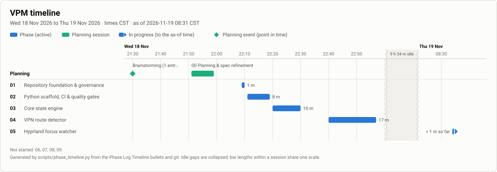
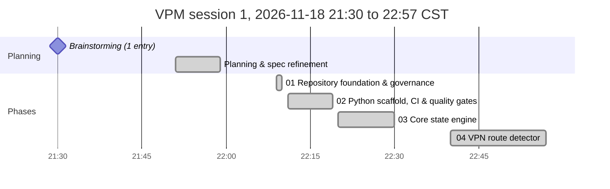
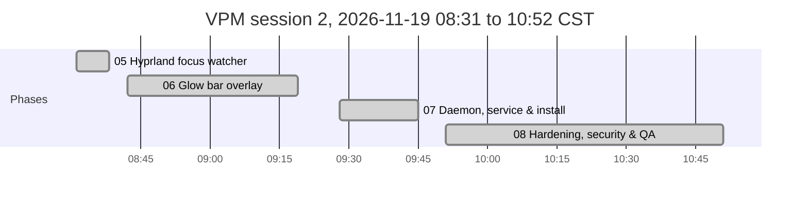
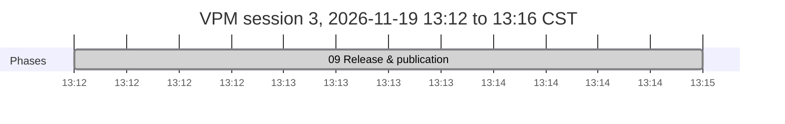

# VPN Monitor v1.0.0: Final report

Written 2026-11-19 13:15 CST (Phase 09). Source of truth for details: [specification](VPM_SPECIFICATION.md), [decisions](VPM_DECISIONS.md), [threat model](VPM_THREAT_MODEL.md), the Phase Log in [the plan](../VPM_IMPLEMENTATION_PLAN.md).

## What was built
An always-on Omarchy/Hyprland add-on. While a browser or Omarchy web app has focus, a thin click-through glow bar on the bottom edge of that monitor is **red** unless internet traffic (IPv4 and IPv6) leaves through a VPN, and **blue** if it does. Anything unknown is red; no browser focused means no bar.

| Part | Module | Notes |
|---|---|---|
| Decision engine (pure, no I/O) | `engine.py`, `browsers.py`, `config.py`, `model.py` | HIDDEN / RED / BLUE per monitor; exhaustive no-false-blue tests (ADR-0013) |
| VPN detector | `vpn.py` | per-family `ip route get`, kernel link-kind classifier (any WireGuard/tun VPN), leak and kill-switch rules, `ip monitor` watcher (ADR-0015) |
| Focus watcher | `focus.py` | Hyprland socket2, window class only, titles dropped at the parser (ADR-0010) |
| Overlay | `overlay.py` | GTK4 + gtk4-layer-shell, per-monitor, fades on the frame clock, no idle redraws (ADR-0017) |
| Daemon, control, CLI, service | `daemon.py`, `control.py`, `cli.py`, `packaging/systemd/` | one deadline timer, fail-safe to red, sandboxed user unit, pause key SUPER+ALT+SHIFT+V (ADR-0018) |
| Logs | `eventlog.py` | human log + JSONL events, 0600, no titles, no URLs, no public IPs |
| Install | `scripts/install.sh`, `uninstall.sh` | idempotent, reversible, home directory only |

Size at release: about 4,800 lines of source, about 5,900 lines of tests, 882 tests, 19 ADRs, 4 spec amendments beyond the original.

## How it meets each brainstorm idea
| # | Idea | Result |
|---|---|---|
| B1 | Part of the operating system | Adopted: systemd user service started at login (Phase 07) |
| B2 | Only while a browser has focus | Adopted: class matcher + Hyprland focus events (Phases 03, 05) |
| B3 | Detect whether the OS is on a VPN | Adopted: route-based, per family, leak-aware (Phase 04) |
| B4 | No VPN: glowing red line at the bottom | Adopted: red bar, approved by Nick (Phase 06) |
| B5 | VPN: glowing blue line | Adopted: blue bar, cross-fade from red (Phase 06) |
| B6 | "Technically feasible?" | Yes, built and measured |

## Measured (reference machine, 2026-11-19)
| What | Measured | Budget |
|---|---|---|
| CPU, no browser focused (10 min) | 0.057 % | ~0 % |
| CPU, Brave focused (10 min) | 0.12 % | < 1 % |
| Memory | PSS 42 to 45 MB | < 80 MB |
| Focus change to first frame | 15 to 75 ms | < 150 ms |
| VPN drop to red | 0.25 s | < 2 s |
| Redraws after a fade | 0 | 0 |

Clean-clone check at release: install, re-install and uninstall against a temporary home (stubbed `systemctl`/`hyprctl`) all exit 0; ruff, ruff format, mypy --strict and 882 tests pass in a fresh clone.

## Known limits
- Route-based: it proves where packets are routed, not that the provider is trustworthy. DNS leaks are not detected (owner question 5, deferred).
- Interface-based VPNs only (IPsec without an interface shows red; a tun2socks proxy counts as a VPN). Blue does not mean the tunnel passes traffic.
- Colour is the only signal (ADR-0019).
- No bar is not "safe": only blue means protected.
- **CI has never run green.** GitHub Actions refuses to start jobs because of an account billing block (owner question 7). The CI recipe was run locally instead on Python 3.12 and 3.14. Re-run the `CI` workflow once billing is fixed.

## Future work
DNS-leak check (needs its own phase); a second non-colour cue; logind `PrepareForSleep` to drop the reading at suspend; slow same-user control clients can stall the loop for up to 0.5 s (accepted). Add any of these with `/phase-add`.

## Release state
Repository stays **private**; no GitHub release (owner question 6, answered 2026-11-19 13:15 CST). Tag `v1.0.0` is pushed to the private repository.

## Timeline
<!-- phase-timeline:start (generated by scripts/phase_timeline.py; do not edit) -->

*Generated from the Phase Log Timeline bullets and git, as of 2026-11-19 13:16 CST. ≈ marks a time inferred from git or a heading. Idle gaps over 60 min start a new chart below and are collapsed in the image. Regenerate with `python3 scripts/phase_timeline.py --write`; do not edit by hand.*

| Phase | Name | Started | Finished | Merged | Active | Blocked | Claim |
|---|---|---|---|---|---:|---:|---|
| brainstorm | Brainstorming (1 entry) | 2026-11-18 21:30 CST |  |  |  |  | n/a |
| 00 | Planning & spec refinement | 2026-11-18 21:51 CST | 21:59 |  | 8 m |  | n/a |
| 01 | Repository foundation & governance | 2026-11-18 22:09 CST | 22:10 | 22:10 | 1 m |  | `d547144` |
| 02 | Python scaffold, CI & quality gates | 2026-11-18 22:11 CST | 22:19 | 22:19 | 8 m |  | `fb6aca4` |
| 03 | Core state engine | 2026-11-18 22:20 CST | 22:30 | 22:30 | 10 m |  | `38929c7` |
| 04 | VPN route detector | 2026-11-18 22:40 CST | 22:57 | 22:57 | 17 m |  | `ac402ee` |
| 05 | Hyprland focus watcher | 2026-11-19 08:31 CST | 08:38 | 08:38 | 7 m |  | `0f2c09f` |
| 06 | Glow bar overlay | 2026-11-19 08:42 CST | 09:19 | 09:19 | 37 m |  | `80167dc` |
| 07 | Daemon, service & install | 2026-11-19 09:28 CST | 09:45 | 09:46 | 17 m |  | `d0c9e5b` |
| 08 | Hardening, security & QA | 2026-11-19 09:51 CST | 10:51 | 10:52 | 1 h |  | `e6af273` |
| 09 | Release & publication | 2026-11-19 13:12 CST | 13:15 | 13:16 | 3 m |  | `ca4a0a9` |

**Totals:** elapsed 15 h 46 m (first recorded start to 2026-11-19 13:16 CST) · active phase time 2 h 40 m (sum over phases) · blocked or paused 0 m · idle 11 h 54 m in 2 gap(s) over 60 min.
<!-- phase-timeline:end -->
